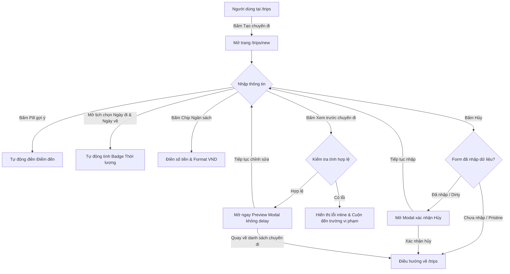

# Kế hoạch Triển khai Giai đoạn 2C.2 — Màn hình Tạo chuyến đi mới (`/trips/new`)

> **Tài liệu đặc tả kiến trúc & kế hoạch thực hiện frontend-only**  
> Phiên bản: 2.0 — Ngày phê duyệt: 18/10/2026  
> Trạng thái: **Đã được Người dùng phê duyệt (Approved)**  

---

## 1. Mục tiêu & Phạm vi (Objectives & Scope)

### 1.1. Mục tiêu
Hiện thực hóa giao diện màn hình **Tạo chuyến đi mới (`/trips/new`)**, đáp ứng Use Case **UC03** trong Release 1, tuân thủ chặt chẽ phong cách thiết kế **Tactile Organic Minimalism** từ Google Stitch (`stitch_smart_trip_dashboard_design/t_o_chuy_n_i/`) và các tiêu chuẩn kỹ thuật từ `docs/ENGINEERING_STANDARDS.md`, `docs/DEFINITION_OF_DONE.md` cùng hướng dẫn UI/UX Pro Max.

### 1.2. Phạm vi thực hiện trong Giai đoạn 2C.2
- **Tuyến đường (Route):** Màn hình `/trips/new` trong Next.js App Router (`src/app/trips/new/page.tsx`).
- **Khối chức năng biểu mẫu:**
  1. **Tên chuyến đi:** Bắt buộc (`*`), độ dài 1–150 ký tự (theo ERD `trips.name varchar(150)`), có gợi ý placeholder và hướng dẫn dưới ô nhập.
  2. **Điểm đến:** **Tùy chọn (Optional)** theo đúng ERD `trips.destination varchar(150)` (không có NOT NULL), không có dấu sao đỏ trên giao diện, độ dài tối đa 150 ký tự nếu nhập. Tích hợp hàng nút gợi ý nhanh (Suggestion Quick Pills) gồm 5 địa danh du lịch phổ biến (Đà Lạt, Sa Pa, Phú Quốc, Quy Nhơn, Ninh Bình).
  3. **Khoảng thời gian (Ngày đi - Ngày về):** Bắt buộc (`*`), hiển thị định dạng `DD/MM/YYYY`, có popup lịch hỗ trợ bàn phím (Escape, Enter, Tab, Arrow) và mobile. Ràng buộc `Ngày về >= Ngày đi` (theo CHECK constraint của ERD), tích hợp badge tính toán thời lượng tự động (ví dụ: `3 ngày 2 đêm`, `1 ngày`). Không cài đặt thêm thư viện ngoài.
  4. **Ngân sách dự kiến:** Không bắt buộc (optional, theo ERD `trips.budget_amount integer`), định dạng số nguyên VND, tích hợp hàng chip chọn nhanh định mức ngân sách (`5 triệu`, `10 triệu`, `20 triệu`, `Tùy chỉnh`).
  5. **Khối thông tin vai trò:** Banner thông báo vai trò "Trưởng nhóm" của người tạo chuyến đi, tuân thủ bộ thuật ngữ chuẩn (`Trưởng nhóm`, không dùng `Host`).
  6. **Cụm nút hành động:**
     - Nút **"Hủy"**: Quay lại `/trips`. Nếu form đã có dữ liệu (dirty), hiển thị modal xác nhận hủy trước khi rời trang để bảo vệ dữ liệu người dùng.
     - Nút chính **"Xem trước chuyến đi"**: Phản ánh trung thực hành vi frontend-only, kiểm tra toàn bộ validation và mở ngay Preview Modal (không dùng độ trễ loading giả 500ms).
  7. **Modal xem trước chuyến đi (Preview Modal Frontend-only):**
     - Hiển thị bản tóm tắt thông tin chuyến đi vừa nhập (Tên chuyến, Điểm đến, Thời gian, Ngân sách, Trưởng nhóm).
     - Thông báo rõ ràng: *Dữ liệu chưa được lưu vào cơ sở dữ liệu PostgreSQL. Hệ thống đang ở giai đoạn giao diện frontend-only.*
     - Có 2 nút hành động: **"Tiếp tục chỉnh sửa"** (đóng modal, giữ nguyên form) và **"Quay về danh sách chuyến đi"** (điều hướng về `/trips`).
- **Cập nhật điều hướng tại `/trips`:**
  - Nối nút "Tạo chuyến đi" trên Header của `/trips` và nút "Tạo chuyến đi đầu tiên" tại Empty State để điều hướng đến `/trips/new`.
  - Giữ nguyên toàn bộ dữ liệu, bộ lọc, thanh số dư và các hành vi khác đã nghiệm thu của `/trips`.

### 1.3. Ngoài phạm vi thực hiện (Out of Scope)
- Không tạo cơ sở dữ liệu PostgreSQL thật, không chạy SQL migration.
- Không triển khai API backend (`POST /api/trips`) hay Route Handler.
- Không thêm chuyến đi mới vào `MOCK_TRIPS` tĩnh của `src/lib/mock-trips.ts`.
- Không thông báo tạo thành công giả vờ và không giả lập request API.
- Không chỉnh sửa landing page (`/`) hoặc trang đăng nhập (`/login`).
- Không triển khai màn hình chi tiết chuyến đi `/trips/[id]`, chức năng thanh toán hoặc các tính năng ngoài phạm vi.

---

## 2. Bằng chứng yêu cầu từ Tài liệu, Use Case & Thiết kế Stitch

| Nguồn tài liệu | Yêu cầu / Quy chuẩn kỹ thuật | Áp dụng vào Giai đoạn 2C.2 |
| :--- | :--- | :--- |
| **Use Case Diagram** (`sodothietke/release1-usecase.drawio`) | **UC03 — Tạo chuyến đi:** Người dùng tạo chuyến mới và hệ thống tự động gán quyền Trưởng nhóm (Host) của chuyến đi đó cho người tạo. | Trang `/trips/new` đóng vai trò là giao diện khởi tạo chuyến đi; hiển thị banner xác nhận vai trò Trưởng nhóm. |
| **Mô hình ERD** (`sodothietke/release1-erd.dbml`) | Bảng `trips`:<br>• `name varchar(150) not null`<br>• `destination varchar(150)` (nullable)<br>• `start_date date not null`<br>• `end_date date not null`<br>• `budget_amount integer` (nullable)<br>• Ràng buộc: `CHECK (end_date >= start_date)` | • `name`: Bắt buộc, 1–150 ký tự.<br>• `destination`: Tùy chọn (khớp ERD), tối đa 150 ký tự.<br>• `startDate` & `endDate`: Bắt buộc, `endDate >= startDate`.<br>• `budget`: Tùy chọn, số nguyên VND. |
| **Quy chuẩn từ ngữ** (`PROJECT_CONTEXT.md` §4) | Phải dùng thuật ngữ **"Trưởng nhóm"**; tuyệt đối không dùng "Host", "Chủ nhóm", "Thủ quỹ" trong UI hướng người dùng. | Banner vai trò trong form ghi rõ: `Bạn sẽ là Trưởng nhóm của chuyến đi này` (thay vì "Bạn sẽ là Host" như trong mẫu Stitch gốc). |
| **Thiết kế Stitch** (`stitch_smart_trip_dashboard_design/t_o_chuy_n_i/`) | • Thẻ form tập trung `max-w-[640px]`, bo góc `rounded-[20px]`, viền gradient đỉnh `from-lime-cream via-ocean-mist to-cerulean`.<br>• Icon `add_location_alt`, tiêu đề `Tạo chuyến đi mới`.<br>• 5 pill gợi ý điểm đến, 4 chip định mức ngân sách.<br>• Badge thời lượng `X ngày Y đêm`. | Giữ trọn vẹn 100% phong cách thiết kế, tỷ lệ kích thước, màu sắc và typography đã được phê duyệt. |
| **UI/UX Pro Max Guidelines** | • Form validation: Inline error kết nối bằng `aria-describedby` và `role="alert"`.<br>• Popup lịch: Hỗ trợ bàn phím (Escape đóng, phím mũi tên duyệt ngày), click outside, responsive mobile.<br>• Touch targets tối thiểu 44–48px. | Triển khai validation rõ ràng, date picker nhẹ nhàng không dependency ngoài, focus trực quan. |

---

## 3. Luồng người dùng & Quy tắc nghiệp vụ (User Flow & Business Rules)

### 3.1. Sơ đồ luồng thao tác người dùng



### 3.2. Quy tắc nghiệp vụ chi tiết
1. **Quy tắc thời lượng chuyến đi:**
   - Khi chưa chọn đủ ngày đi hoặc ngày về: Badge thời lượng hiển thị placeholder hướng dẫn (hoặc ẩn).
   - Khi chọn đủ ngày đi và ngày về hợp lệ:
     - Cùng ngày ($N = 1$): `1 ngày`.
     - Chênh lệch 1 ngày: `2 ngày 1 đêm`.
     - Chênh lệch 2 ngày: `3 ngày 2 đêm`.
     - Tổng quát: $N$ ngày, $N-1$ đêm (với $N = \text{ngày kết thúc} - \text{ngày bắt đầu} + 1$).
   - Nếu $Ngày về < Ngày đi$: Hiển thị cảnh báo lỗi tức thì `Ngày về phải sau hoặc cùng ngày với ngày khởi hành.`
2. **Quy tắc điểm đến (Theo quyết định phê duyệt):**
   - Giữ tương thích 100% với ERD: Điểm đến là trường tùy chọn (optional).
   - Bỏ dấu sao đỏ `*` trên giao diện.
   - Nếu người dùng để trống: Hợp lệ.
   - Nếu người dùng nhập hoặc bấm chọn pill: Tối đa 150 ký tự.
3. **Quy tắc tiền tệ & Ngân sách dự kiến:**
   - Ngân sách là trường tùy chọn. Người dùng có thể để trống.
   - Khi nhập số, trường tự động định dạng chuẩn Việt Nam: dấu chấm phân tách hàng nghìn (ví dụ `10.000.000`), có hậu tố ký hiệu tiền tệ `₫` cố định bên phải.
   - Bấm chip `5 triệu`, `10 triệu`, `20 triệu` sẽ gán trực tiếp giá trị tương ứng (`5.000.000`, `10.000.000`, `20.000.000`). Bấm chip `Tùy chỉnh` sẽ xóa trắng ô nhập và focus con trỏ để người dùng tự gõ.
4. **Quy tắc bảo vệ dữ liệu khi Hủy (Unsaved Changes Warning):**
   - Nếu form chưa có dữ liệu (pristine): Bấm "Hủy" điều hướng ngay về `/trips`.
   - Nếu form đã có dữ liệu (dirty): Mở modal xác nhận hủy:
     - Tiêu đề: *Hủy tạo chuyến đi?*
     - Nội dung: *Các thông tin bạn vừa nhập sẽ không được lưu. Bạn có chắc chắn muốn quay lại danh sách chuyến đi?*
     - Nút: `Tiếp tục nhập` (đóng modal) và `Xác nhận hủy` (điều hướng về `/trips`).

---

## 4. Phương án Giao diện, Responsive & Tái sử dụng Component

### 4.1. Kiến trúc Bố cục Giao diện
- **Header:** Tái sử dụng `src/components/layout/app-header.tsx` (chiều cao 72px cố định, logo Smart Trip, menu điều hướng, chuông thông báo, avatar tài khoản Lan).
- **Vùng nội dung chính:**
  - Nền trang: `bg-bg-canvas` (`#F4F9EC`).
  - Nút quay lại: `<Link href="/trips">` với icon `ArrowLeft`, nhãn "Quay lại danh sách chuyến đi".
  - Thẻ chứa biểu mẫu (Card): Chiều rộng cố định tối đa `max-w-[640px]`, căn giữa màn hình, viền gradient đỉnh `from-lime-cream via-ocean-mist to-cerulean`, bo góc `rounded-[20px]`, nền trắng `bg-white`, đổ bóng `shadow-[0_6px_20px_rgba(24,78,119,0.08)]`.
  - Banner vai trò Trưởng nhóm: Nền `bg-hover-row` (`#EEF6E4`), icon huy hiệu sao nền `bg-lime-cream` (`#D9ED92`), viền mềm mại.
  - Chân form: Ghi chú trấn an thân thiện: *"Cần chia sẻ chi phí theo nhiều tỷ lệ khác nhau? Sau khi tạo chuyến đi, bạn có thể thiết lập người chịu chi phí linh hoạt từng khoản."*
- **Footer:** Tái sử dụng `src/components/layout/app-footer.tsx` (bản quyền, liên kết điều khoản và chính sách mẫu).

### 4.2. Thích ứng Responsive
- **Desktop (1280px+):** Form căn giữa, khối ngày đi - ngày về hiển thị song song với mũi tên nối giữa, padding `p-8`.
- **Tablet (768px):** Padding `p-6 sm:p-8`, các pill và chip tự động bọc dòng (`flex-wrap`).
- **Mobile (375px):** Padding `p-5 sm:p-6`, khối ngày co giãn tối ưu, touch targets $\ge 44\text{px}$, nút bấm thao tác dễ dàng trên màn hình nhỏ.

---

## 5. Danh sách File dự kiến Tạo mới & Cập nhật

```text
src/
  app/
    trips/
      new/
        page.tsx                           # [TẠO MỚI] Route trang Tạo chuyến đi mới
      page.tsx                             # [CẬP NHẬT] Nối nút tạo chuyến sang /trips/new
  components/
    trips/
      create-trip-form.tsx                 # [TẠO MỚI] Component biểu mẫu tạo chuyến đi chính
      trip-date-picker.tsx                 # [TẠO MỚI] Bộ chọn ngày popup chuẩn Stitch (DD/MM/YYYY, Escape, keyboard)
      destination-quick-pills.tsx          # [TẠO MỚI] Cụm pill chọn nhanh điểm đến gợi ý
      budget-preset-chips.tsx              # [TẠO MỚI] Cụm chip chọn nhanh hạn mức ngân sách
      create-trip-preview-modal.tsx        # [TẠO MỚI] Modal xem trước chuyến đi & ranh giới frontend-only
      confirm-cancel-modal.tsx             # [TẠO MỚI] Modal xác nhận khi hủy form dirty
  lib/
    trip-form-validation.ts                # [TẠO MỚI] Module validation logic thuần túy (pure functions)
  types/
    trip.ts                                # [CẬP NHẬT] Bổ sung interface CreateTripFormData & Errors
tests/
  create-trip-validation.test.mjs          # [TẠO MỚI] Unit tests kiểm thử toàn diện form validation
```

---

## 6. Quy tắc Xác thực Dữ liệu & Xử lý Lỗi (Validation Specifications)

| Trường thông tin | Ràng buộc kỹ thuật | Thông báo lỗi tương ứng |
| :--- | :--- | :--- |
| **Tên chuyến đi** (`name`) | • Bắt buộc nhập.<br>• Sau khi trim: độ dài từ 2 đến 150 ký tự. | • Để trống: `Vui lòng nhập tên chuyến đi.`<br>• Dưới 2 ký tự: `Tên chuyến đi phải có ít nhất 2 ký tự.`<br>• Quá 150 ký tự: `Tên chuyến đi không được vượt quá 150 ký tự.` |
| **Điểm đến** (`destination`) | • Tùy chọn (khớp ERD `destination varchar(150)`).<br>• Nếu nhập: tối đa 150 ký tự. | • Quá 150 ký tự: `Điểm đến không được vượt quá 150 ký tự.` |
| **Ngày đi** (`startDate`) | • Bắt buộc chọn.<br>• Phải là ngày lịch hợp lệ (không chấp nhận ngày ảo như 31/02). | • Để trống: `Vui lòng chọn ngày khởi hành.`<br>• Không hợp lệ: `Ngày khởi hành không đúng định dạng lịch.` |
| **Ngày về** (`endDate`) | • Bắt buộc chọn.<br>• Phải là ngày lịch hợp lệ.<br>• **Bắt buộc:** `endDate >= startDate`. | • Để trống: `Vui lòng chọn ngày kết thúc.`<br>• Nhỏ hơn ngày đi: `Ngày về phải sau hoặc cùng ngày với ngày khởi hành.` |
| **Ngân sách dự kiến** (`budgetAmount`) | • Tùy chọn (có thể để trống).<br>• Nếu nhập: phải là số nguyên $\ge 0$ và $\le 10.000.000.000$ ₫ (10 tỷ đồng). | • Số âm hoặc không hợp lệ: `Ngân sách dự kiến phải là số tiền hợp lệ.`<br>• Vượt hạn mức: `Ngân sách dự kiến không được vượt quá 10 tỷ đồng.` |

---

## 7. Chiến lược Mock Data, Không Backend & Hành vi Submit

- **Nút submit chính:** Mang tên **"Xem trước chuyến đi"**.
- Khi người dùng bấm nút:
  - Form chạy hàm `validateCreateTripForm(formData)`.
  - Nếu có lỗi: hiển thị lỗi inline dưới từng trường vi phạm, cuộn/focus đến ô lỗi đầu tiên, hiển thị toast cảnh báo: `Vui lòng kiểm tra lại các trường thông tin bắt buộc.`
  - Nếu hợp lệ: **Mở ngay lập tức Preview Modal** (không delay 500ms).
- **Nội dung Preview Modal:**
  - Tóm tắt đầy đủ thông tin chuyến đi: Tên chuyến, Điểm đến (nếu có, hoặc hiển thị "Chưa thiết lập"), Ngày đi – Ngày về, Thời lượng tính toán, Ngân sách dự kiến, Người tạo (Lan Nguyễn - Trưởng nhóm).
  - Cảnh báo ranh giới kỹ thuật: *Hệ thống đang hoạt động ở chế độ giao diện Giai đoạn 2C.2 (Frontend-only). Quy trình lưu chuyến đi vào cơ sở dữ liệu PostgreSQL và phân quyền Trưởng nhóm sẽ được kết nối chính thức khi triển khai API backend (UC03). Dữ liệu vừa nhập chưa được lưu vào hệ thống.*
  - Hai nút hành động:
    - **"Tiếp tục chỉnh sửa"**: Đóng modal, giữ nguyên trạng thái form.
    - **"Quay về danh sách chuyến đi"**: Đóng modal và điều hướng về `/trips`.
- Tuyệt đối không thêm dữ liệu vào `MOCK_TRIPS`, không thông báo "Tạo chuyến đi thành công" giả lập.

---

## 8. Kế hoạch Kiểm thử & Visual QA

### 8.1. Kiểm thử đơn vị (`tests/create-trip-validation.test.mjs`)
1. Xác thực tên chuyến đi (hợp lệ, rỗng, khoảng trắng, vượt 150 ký tự).
2. Xác thực điểm đến (để trống hợp lệ, nhập hợp lệ, vượt 150 ký tự báo lỗi).
3. Xác thực ngày tháng:
   - Ngày đi và ngày về hợp lệ.
   - Ngày về trước ngày đi (bị từ chối).
   - Ngày không tồn tại trong lịch (ví dụ 31/02/2026).
   - Ngày đi trùng ngày về (hợp lệ, 1 ngày).
4. Tính toán thời lượng `durationText` (`1 ngày`, `2 ngày 1 đêm`, `3 ngày 2 đêm`, `5 ngày 4 đêm`).
5. Xác thực ngân sách dự kiến (để trống, số hợp lệ, parse từ chip preset, số âm).

### 8.2. Tiêu chuẩn tự động hóa
- `npm test`: Đạt 100% (25 test cũ + test mới).
- `npm run lint`: 0 lỗi, 0 cảnh báo.
- `npm run build`: Biên dịch production thành công, route `/trips/new` tĩnh.

### 8.3. Tiêu chí Visual QA (Chụp ảnh bằng Browser Subagent)
Lưu vào thư mục `tests/reports/phase-2c2/`:
1. `create_trip_desktop_1280px.png`: Màn hình tạo chuyến trên Desktop (1280x800).
2. `create_trip_tablet_768px.png`: Màn hình tạo chuyến trên Tablet (768x1024).
3. `create_trip_mobile_375px.png`: Màn hình tạo chuyến trên Mobile (375x812).
4. `create_trip_datepicker_open.png`: Popup lịch hoạt động mượt mà.
5. `create_trip_validation_errors.png`: Giao diện hiển thị lỗi inline khi để trống tên hoặc ngày về < ngày đi.
6. `create_trip_preview_modal.png`: Preview Modal hiển thị tóm tắt và cảnh báo ranh giới frontend-only.
7. `create_trip_cancel_confirm_modal.png`: Modal xác nhận hủy khi form dirty.

---

## 9. Definition of Done & Tiêu chí Nghiệm thu

- [ ] Giao diện khớp chính xác thiết kế Stitch `t_o_chuy_n_i` và tiêu chuẩn UI/UX Pro Max.
- [ ] Điểm đến là trường tùy chọn, tương thích 100% với ERD `destination varchar(150)`.
- [ ] Nút submit "Xem trước chuyến đi" mở Preview Modal ngay, trung thực không giả vờ gọi API.
- [ ] Bộ chọn ngày `DD/MM/YYYY` có popup lịch, hỗ trợ Escape, phím bấm, responsive.
- [ ] Nút tạo chuyến đi trên `/trips` và Empty State điều hướng đúng đến `/trips/new`.
- [ ] Modal xác nhận hủy hoạt động khi form dirty.
- [ ] Không có lỗi console, lỗi runtime hoặc lỗi hydration.
- [ ] `npm test`, `npm run lint`, `npm run build` đều pass với exit code 0.
- [ ] Có đầy đủ ảnh chụp Visual QA mới tại `tests/reports/phase-2c2/`.
- [ ] Tạo Git commit riêng, không sửa lịch sử commit cũ.
