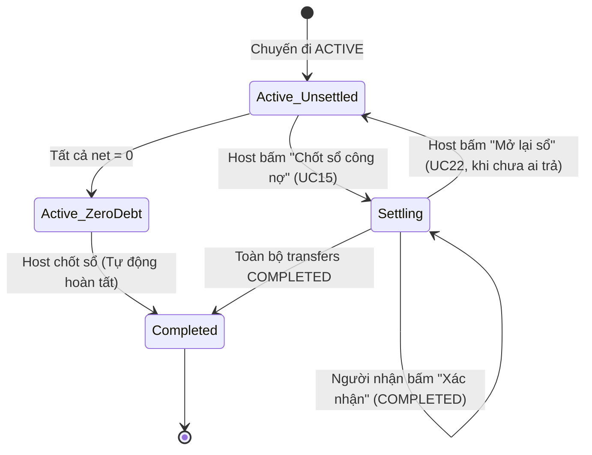

# Kế hoạch triển khai Giai đoạn 2D.3 — Quyết toán, Công nợ & Đề xuất thanh toán (Settlement & Repayments)

> **Dự án:** Smart Trip & Expense Planner (Release 1)  
> **Tài liệu:** Kế hoạch kỹ thuật & Đặc tả giao diện phân hệ Công nợ (Phase 2D.3)  
> **Trạng thái:** ✅ **ĐÃ PHÊ DUYỆT BỞI NGƯỜI DÙNG — SẴN SÀNG TRIỂN KHAI** (Quyết định duyệt ngày 19/10/2026)  
> **Căn cứ nghiệp vụ & kỹ thuật:**  
> - Use Case: UC15 (Chốt sổ), UC16 (Rút gọn nợ), UC17 (Xem bảng công nợ), UC18 (Tạo QR thanh toán), UC19 (Thanh toán nợ), UC20 (Xác nhận đã nhận tiền), UC22 (Mở lại sổ), UC29 (Nhắc nợ).  
> - ERD: Bảng `settlements`, `settlement_transfers`, `expenses`, `expense_shares`, `trip_members`, `trips`.  
> - Sơ đồ tuần tự: SD2 (Chốt sổ & Rút gọn nợ), SD3 (Thanh toán, tạo QR & Xác nhận), SD4 (Mở lại sổ công nợ) trong `sodothietke/release1-sequence.md`.  
> - Thiết kế Google Stitch: `c_ng_n_l_t_3n2`, `thanh_to_n_cho_minh_modal_c_ng_n`, `vietqr_banking_code`, `nh_c_n_modal_l_t_3n2`.  
> - Module tiền hiện có: `src/lib/money/simplify.ts`, `src/lib/money/format.ts`, `src/lib/trips/balance.ts`.

---

## 1. Mục tiêu và phạm vi triển khai

### 1.1 Mục tiêu chính
Giai đoạn 2D.3 hoàn thiện phân hệ **Quyết toán & Công nợ (Settlement)** trên giao diện web Smart Trip, giúp các thành viên sau chuyến đi nắm bắt chính xác nghĩa vụ tài chính, rút gọn số lần chuyển khoản và hoàn tất quyết toán minh bạch:
1. **Tổng hợp số dư công nợ từng thành viên:** Tính toán minh bạch `paid` (đã trả), `owed` (phải chịu) và `net = paid - owed` (số dư ròng). Phân định rõ ràng: người cần nhận tiền (`net > 0`), người cần trả tiền (`net < 0`) và người đã cân bằng (`net = 0`).
2. **Rút gọn công nợ bằng thuật toán tham lam (Greedy Debt Simplification):** Tận dụng module [`src/lib/money/simplify.ts`](file:///c:/Users/admin/Downloads/doanweb/src/lib/money/simplify.ts) để triệt tiêu các khoản nợ chéo trung gian, tạo danh sách các giao dịch thanh toán đề xuất trực tiếp giữa con nợ và chủ nợ. Không tuyên bố "tối ưu tuyệt đối" hay "số giao dịch tối thiểu tuyệt đối".
3. **Vòng đời chốt sổ & mở lại sổ an toàn:**
   - **Xem trước công nợ khi ACTIVE:** Cho phép xem bảng công nợ tạm tính khi chuyến đi ở trạng thái `ACTIVE` với nhãn "Công nợ tạm tính" rõ ràng; số liệu phản ánh các khoản chi hiện có. Không cho phép xác nhận đã thanh toán, nhận tiền hoặc thao tác thanh toán trước khi chốt sổ. Chỉ Trưởng nhóm được chốt sổ.
   - **Chốt sổ (UC15):** Trưởng nhóm (`HOST`) chốt sổ → chuyển trạng thái chuyến đi sang `SETTLING` và khóa toàn bộ chức năng thêm/sửa/xóa khoản chi theo Quy tắc R7.
   - **Mở lại sổ (UC22):** Trưởng nhóm có quyền mở lại sổ khi trạng thái là `SETTLING` nếu và **CHỈ KHI toàn bộ giao dịch là `UNPAID`**. Nếu có bất kỳ giao dịch nào là `PAID` hoặc `COMPLETED`, vô hiệu hóa nút mở lại và giải thích rõ lý do. Khi mở lại, chuyển settlement cũ sang `CANCELLED` và trả chuyến đi về `ACTIVE`.
4. **Thao tác thanh toán & xác nhận đối soát:**
   - Đề xuất thanh toán (`UNPAID` — Chưa thanh toán).
   - Người nợ thực hiện chuyển tiền ngoài hệ thống và bấm đánh dấu (`PAID` — Đã thanh toán, chờ xác nhận). Hỗ trợ xem thông tin STK và mã VietQR mô phỏng (SVG nội bộ kèm ghi chú minh họa, không gọi dịch vụ bên ngoài, không dùng STK thật).
   - Người nhận tiền kiểm tra tài khoản và xác nhận (`COMPLETED` — Đã nhận / Đã đối soát). Khi toàn bộ giao dịch đạt `COMPLETED`, chuyến đi tự động chuyển sang trạng thái `COMPLETED` (Đã hoàn tất).
   - **Thao tác hộ của Trưởng nhóm (Quy tắc R12):** Hỗ trợ "Đánh dấu đã thanh toán (Trả hộ)" khi con nợ là thành viên chưa có tài khoản; hỗ trợ "Xác nhận đã nhận tiền (Nhận hộ)" khi chủ nợ là thành viên chưa có tài khoản. Luôn có bước xác nhận trước khi thay đổi trạng thái trong phiên demo.
5. **Công cụ hỗ trợ thanh toán:**
   - Modal xem mã VietQR & STK chuyển khoản (chuẩn Napas 24/7 mô phỏng, kèm cảnh báo demo).
   - Modal Nhắc nợ (UC29) với 3 phong cách (Lịch sự, Thân mật, Hài hước) cho phép sao chép nội dung gửi qua Zalo/SMS.
   - Modal Sơ đồ bù trừ nợ thông minh minh họa các nhánh nợ trung gian đã được triệt tiêu.

### 1.2 Ranh giới phạm vi (Scope Boundaries — Release 1)

| Hạng mục | Trong phạm vi Release 1 (Giai đoạn 2D.3) | Nằm ngoài phạm vi Release 1 (Tuyệt đối không làm) |
|---|---|---|
| **Dữ liệu & Backend** | • Quản lý công nợ, settlement và transfers hoàn toàn trong phiên demo (`in-session state` qua `TripSessionContext`). • Tự động tính toán lại khi có khoản chi mới thêm trong phiên. | • Không viết API backend thật, không tạo bảng PostgreSQL, không chạy migration Prisma. • Không lưu dữ liệu bền vững qua database. |
| **Thanh toán & Ngân hàng** | • Hiển thị STK, tên chủ thẻ, ngân hàng từ dữ liệu mock. • Hiển thị mã QR VietQR mô phỏng bằng SVG vector nội bộ. • Có nhãn và ghi chú bắt buộc: *"Minh họa — chưa hỗ trợ thanh toán thật; chuyển khoản thực tế qua ứng dụng ngân hàng ngoài hệ thống"*. • Người nợ chủ động đánh dấu "Tôi đã chuyển" / "Tôi đã trả tiền mặt". | • Không tích hợp cổng thanh toán (VNPay, ZaloPay, PayOS, MoMo). • Không gọi API tạo link thanh toán động hay webhook Open Banking. • Không lưu số thẻ tín dụng, mã PIN, OTP. • Không có tính năng "Ví chuyến đi" (Trip Wallet). |
| **Quyền hạn & Nghiệp vụ** | • Chỉ Trưởng nhóm (`HOST`) được bấm "Chốt sổ" và "Mở lại sổ". • Trưởng nhóm được thao tác thanh toán/xác nhận thay cho thành viên chưa có tài khoản (`isNoAccount: true`). | • Thành viên thường không được chốt/mở lại sổ. • Không cho phép sửa khoản chi khi chuyến đi đã chốt sổ. |

---

## 2. Bằng chứng yêu cầu nghiệp vụ và kiến trúc

### 2.1 Căn cứ tài liệu gốc
1. **Use Case Diagram (`sodothietke/release1-usecase.drawio`):**
   - **UC15:** Chốt sổ công nợ.
   - **UC16:** Rút gọn nợ bằng thuật toán.
   - **UC17:** Xem bảng công nợ ("Ai trả ai bao nhiêu").
   - **UC18:** Tạo QR thanh toán chuyển khoản.
   - **UC19:** Thanh toán khoản nợ (đánh dấu đã chuyển tiền).
   - **UC20:** Xác nhận đã nhận tiền từ người nợ.
   - **UC22:** Mở lại sổ công nợ (khi chưa ai thanh toán).
   - **UC29:** Nhắc nợ thành viên chậm chuyển tiền.
2. **Sơ đồ tuần tự (`sodothietke/release1-sequence.md`):**
   - **SD2 (Chốt sổ & rút gọn nợ):** Host bấm Chốt sổ → Xác nhận cảnh báo → Tính `net = paid - owed` → Kiểm tra bất biến $\sum \text{net} = 0$ → Chạy `simplify(net)` → Tạo `settlements` (ACTIVE) và `settlement_transfers` (UNPAID) → Cập nhật `trips.status = SETTLING`. Nếu tất cả `net = 0` → Cập nhật `trips.status = COMPLETED`.
   - **SD3 (Thanh toán & xác nhận):** Người nợ bấm "Thanh toán" → Hiển thị STK / VietQR → Người nợ quét app ngân hàng ngoài hệ thống → Bấm "Tôi đã thanh toán" (`transfer.status = PAID`) → Người nhận thấy khoản đã trả → Bấm "Xác nhận đã nhận" (`transfer.status = COMPLETED`) → Khi toàn bộ transfers xong, chuyến đi chuyển `COMPLETED`.
   - **SD4 (Mở lại sổ):** Host bấm "Mở lại sổ" → Kiểm tra nếu có transfer nào `status != UNPAID` thì chặn (báo lỗi không thể mở lại) → Nếu toàn bộ `UNPAID` thì chuyển `settlement.status = CANCELLED`, `trips.status = ACTIVE`.
3. **Mô hình thực thể ERD (`sodothietke/release1-erd.dbml`):**
   - Bảng `settlements`: `id`, `trip_id`, `status` (`ACTIVE | CANCELLED`), `created_by_member_id`, `created_at`, `cancelled_at`.
   - Bảng `settlement_transfers`: `id`, `settlement_id`, `from_member_id`, `to_member_id`, `amount`, `status` (`UNPAID | PAID | COMPLETED`), `payment_method` (`BANK_TRANSFER | CASH`), `paid_at`, `paid_marked_by_member_id`, `completed_at`, `completed_by_member_id`.
   - Bảng `trips`: Cột `status` với 4 trạng thái (`ACTIVE`, `SETTLING`, `COMPLETED`, `ARCHIVED`).
4. **Quy tắc nghiệp vụ chốt (`PROJECT_CONTEXT.md`):**
   - Quy tắc R7: Sau khi chốt sổ (`SETTLING` hoặc `COMPLETED`), khóa chức năng thêm/sửa/xóa khoản chi.
   - Quy tắc R8, R17: Hỗ trợ cả 2 hình thức: chuyển khoản ngân hàng và tiền mặt. Nếu người nhận chưa có STK, cảnh báo và hướng dẫn trả tiền mặt hoặc nhắc cập nhật hồ sơ.
   - Quy tắc R12: Trưởng nhóm thao tác thay cho thành viên chưa có tài khoản (`isNoAccount`).

---

## 3. Công thức toán học & Module tiền hiện có

### 3.1 Công thức tính số dư ròng từng thành viên (Net Balance)
Với mỗi thành viên $m$ thuộc chuyến đi (`trip.members` có `status === "ACTIVE"`):
1. **Tổng tiền đã ứng trả (`paidAmount`):**
   $$\text{paid}(m) = \sum \{ e.\text{amount} \mid e \in \text{expenses}, e.\text{paidByMemberId} = m.\text{id} \}$$
2. **Tổng tiền phải gánh chịu (`owedAmount`):**
   $$\text{owed}(m) = \sum \{ s.\text{amount} \mid e \in \text{expenses}, s \in e.\text{shares}, s.\text{memberId} = m.\text{id} \}$$
3. **Số dư ròng (`netBalance`):**
   $$\text{net}(m) = \text{paid}(m) - \text{owed}(m)$$

### 3.2 Bất biến số học bắt buộc (Financial Invariants)
Mọi phép tính toán công nợ phải thỏa mãn 3 bất biến số học tuyệt đối:
1. **Bất biến bảo toàn dòng tiền:**
   $$\sum_{m} \text{paid}(m) \equiv \sum_{m} \text{owed}(m) \equiv \text{totalSpent}$$
2. **Bất biến tổng số dư ròng triệt tiêu (Zero-Sum Invariant):**
   $$\sum_{m} \text{net}(m) \equiv 0$$
   *Nếu $\sum \text{net}(m) \neq 0$, hệ thống phải nhận diện đây là lỗi dữ liệu nội bộ nghiêm trọng và từ chối sinh đề xuất công nợ.*
3. **Số nguyên VND an toàn:**
   Toàn bộ `paid`, `owed`, `net` và `transfer.amount` bắt buộc phải là số nguyên an toàn (`Number.isSafeInteger`) theo đơn vị đồng (VND), không dùng số thập phân.

### 3.3 Thuật toán rút gọn nợ trong `src/lib/money/simplify.ts`
Hàm `simplify(net: Record<string, number>): DebtTransaction[]` đã được xây dựng sẵn trong dự án với các đặc điểm:
- **Nguyên lý tham lam (Greedy Bipartite Matching):** Tại mỗi vòng lặp, sắp xếp danh sách người nợ (`net < 0`) giảm dần theo số tiền nợ và người nhận (`net > 0`) giảm dần theo số tiền nhận. Khớp số tiền thanh toán $\min(\text{debtor}, \text{creditor})$, bù trừ và loại bỏ người đã về 0.
- **Tính tất định (Deterministic Tie-break):** Khi số tiền bằng nhau, thuật toán tie-break theo mã ký tự `id` tăng dần (`a.id < b.id ? -1 : 1`). Kết quả chạy nhiều lần trên cùng dữ liệu luôn cho ra các giao dịch giống nhau $100\%$.
- **Giới hạn số giao dịch:** Đảm bảo tạo ra không quá $(K - 1)$ giao dịch, trong đó $K$ là số người có số dư khác 0.
- **Tuyên bố minh bạch:** Đây là thuật toán xấp xỉ tham lam (Greedy Heuristic) mang lại hiệu quả thực tế cao (thường giảm $60\% - 80\%$ số lần chuyển tiền), **không cam kết luôn đạt số lượng giao dịch tối thiểu tuyệt đối toán học (NP-hard subset sum)**.

---

## 4. Thiết kế luồng người dùng và cấu trúc giao diện

### 4.1 Điều hướng Tab Công nợ
Tab Công nợ nằm tại đường dẫn: `/trips/[id]/settlement`.
Component chính `TripSettlementTab` sẽ thay thế `TripTabPlaceholder` hiện tại.

### 4.2 Các trạng thái vòng đời của màn hình Công nợ

Giao diện tự động thích ứng theo trạng thái của chuyến đi (`trip.status`):

#### Trạng thái 1: Chuyến đi đang mở (`trip.status === "ACTIVE"`) — Xem trước tạm tính (Live Preview)
- **Mục đích:** Thành viên theo dõi số dư tạm tính theo thời gian thực khi các khoản chi vẫn đang được ghi nhận.
- **Banner đầu trang:** Huy hiệu màu xanh nhạt `Lime Cream`: *"Bản xem trước công nợ tạm tính — Chuyến đi chưa chốt sổ"*.
- **Hành động của Trưởng nhóm (`HOST`):** Nút nổi bật `Chốt sổ công nợ` (màu Cerulean, icon Khóa/Check).
- **Hành động của Thành viên thường:** Hiển thị thông báo hướng dẫn: *"Chờ Trưởng nhóm chốt sổ để tiến hành thanh toán chính thức"*.
- **Tab Chi tiêu:** Nút `Thêm khoản chi` vẫn hoạt động bình thường.

#### Trạng thái 2: Chốt sổ công nợ (UC15)
- Khi Host bấm `Chốt sổ công nợ`, mở `TripSettlementConfirmModal`:
  - Tiêu đề: *"Xác nhận chốt sổ chi tiêu chuyến đi"*.
  - Cảnh báo rõ: *"Sau khi chốt sổ, toàn bộ chức năng thêm, sửa, xóa khoản chi tiêu sẽ bị khóa lại theo quy tắc R7. Hệ thống sẽ chốt danh sách chuyển tiền theo số dư hiện tại."*
  - Nếu xác nhận:
    - Nếu có giao dịch chuyển tiền: Cập nhật `trip.status = "SETTLING"`, tạo settlement `status: "ACTIVE"`, sinh danh sách transfers `status: "UNPAID"`.
    - Nếu tất cả `net = 0`: Cập nhật `trip.status = "COMPLETED"`, hiển thị màn hình chúc mừng *"Không ai nợ ai"*.

#### Trạng thái 3: Đang quyết toán (`trip.status === "SETTLING"`) — Bảng giao dịch chính thức
- **Banner đầu trang:** Nền vàng cam / xanh dương nổi bật: *"Đã chốt sổ — Đã rút gọn từ X khoản nợ chéo xuống còn Y giao dịch"*.
- **Bảng "Ai trả ai bao nhiêu":** Hiển thị từng dòng giao dịch:
  - Cột Người trả (Avatar, Tên, Huy hiệu `Bạn` nếu là người dùng hiện tại).
  - Cột Mũi tên chuyển tiền (`arrow_forward`).
  - Cột Người nhận (Avatar, Tên, Huy hiệu `Thủ quỹ` / `Trưởng nhóm`).
  - Cột Số tiền (In đậm, màu sắc tương phản cao, `tabular-nums`).
  - Cột Trạng thái với 3 badge chuẩn Stitch:
    - `UNPAID`: Huy hiệu cam đỏ nhấp nháy `Chưa thanh toán`.
    - `PAID`: Huy hiệu xanh biển `Đã thanh toán (Chờ xác nhận)`.
    - `COMPLETED`: Huy hiệu xanh lá `Đã hoàn tất`.
  - Cột Thao tác:
    - Nếu là người nợ (hoặc Host thao tác hộ): Nút `Thanh toán` (khi `UNPAID`).
    - Nếu là người nhận (hoặc Host nhận hộ): Nút `Xác nhận đã nhận` (khi `PAID`).
    - Nút `Nhắc nợ` (khi `UNPAID` hoặc `PAID` quá lâu).
- **Hành động của Trưởng nhóm (`HOST`):**
  - Nút `Mở lại sổ công nợ`:
    - Nếu **toàn bộ transfers đều là `UNPAID`**: Nút kích hoạt. Bấm vào mở modal xác nhận mở lại sổ. Xác nhận xong → hủy settlement, trả `trip.status = "ACTIVE"`, mở khóa tab Chi tiêu.
    - Nếu **đã có ít nhất 1 transfer là `PAID` hoặc `COMPLETED`**: Nút bị mờ/khóa (`disabled`), tooltip giải thích: *"Không thể mở lại sổ vì đã có thành viên thực hiện thanh toán. Vui lòng hoàn tất quyết toán."*

#### Trạng thái 4: Đã hoàn tất quyết toán (`trip.status === "COMPLETED"`)
- Khi giao dịch cuối cùng được xác nhận `COMPLETED`:
  - Tự động hiển thị huy hiệu `Đã quyết toán hoàn tất 100%`.
  - Toàn bộ các dòng giao dịch đều ở trạng thái `Đã đối soát`.
  - Hiển thị thông báo chúc mừng nhóm đã hoàn tất mọi nghĩa vụ tài chính sòng phẳng.

#### Trạng thái 5: Empty States đặc biệt
1. **Chưa có khoản chi nào (`expenses.length === 0`):**
   - Minh họa ví tiền rỗng, thông báo: *"Chưa có khoản chi nào được ghi nhận. Hãy thêm khoản chi tại tab Chi tiêu trước khi chốt sổ công nợ."*
2. **Không ai nợ ai ($\text{net}(m) = 0$ cho mọi $m$):**
   - Minh họa cân bằng tài chính vui tươi, thông báo: *"Tuyệt vời! Chi phí chuyến đi đã được chia đều hoàn hảo, không ai nợ ai."*

---

### 4.3 Cấu trúc bố cục trang (12-Column Responsive Layout)

Tuân thủ thiết kế Stitch `c_ng_n_l_t_3n2`:

1. **Khối Header & Tóm tắt tổng quan (Full-width Top Banner):**
   - Nền màu `#EAF4CC`, bo góc `rounded-[20px]`.
   - Hiển thị số lượng giao dịch đã rút gọn: *"Đã rút gọn từ X khoản nợ chéo xuống còn Y giao dịch"*.
   - Huy hiệu thuật toán: `Chuẩn thuật toán nợ tối giản`.
   - Nút `Xem sơ đồ bù trừ` mở `TripSettlementGraphModal`.
   - Nút `Chốt sổ công nợ` (khi `ACTIVE`) hoặc `Mở lại sổ` (khi `SETTLING`).

2. **Cột trái (8 Columns Desktop — Nội dung chính):**
   - **Bảng "Ai trả ai bao nhiêu" (`TripSettlementTable`):** Danh sách các khoản thanh toán đề xuất, responsive cuộn ngang trên tablet/mobile.
   - **Dải băng hỗ trợ VietQR:** Thông tin hỗ trợ Napas 24/7 và chuyển khoản liên ngân hàng nhanh chóng.
   - **Khối giáo dục thuật toán (3 Thẻ trực quan):**
     - Thẻ 1: *Trước khi tối ưu* (X giao dịch chéo, cảnh báo dễ nhầm lẫn).
     - Thẻ 2: *Thuật toán bù trừ* (Gộp ròng, tính toán theo số dư cuối kỳ).
     - Thẻ 3: *Kết quả sau rút gọn* (Y giao dịch, tiện lợi nhất cho nhóm).

3. **Cột phải (4 Columns Desktop, Sticky Top — Bảng số dư):**
   - **Thẻ 1: "Số dư của bạn" (`TripMyBalanceCard`):**
     - Hiển thị số tiền bạn cần trả (âm - màu đỏ `#B42318`) hoặc bạn được nhận (dương - màu xanh `#2E7D5B`) hoặc đã cân bằng (`0 ₫`).
     - Lời nhắn hướng dẫn hành động tương ứng.
     - Nút hành động nhanh: `Thanh toán ngay X ₫` (nếu bạn nợ) hoặc `Thông tin nhận tiền` (nếu bạn là chủ nợ).
     - Khung thông tin tài khoản người nhận đề xuất kèm nút `Sao chép số tài khoản`.
   - **Thẻ 2: "Số dư thành viên" (`TripMembersNetBalanceCard`):**
     - Danh sách toàn bộ thành viên chuyến đi kèm nhãn trạng thái: `Được nhận` (xanh), `Cần trả` (cam/đỏ), `Đã cân bằng` (xám).
     - Khối kiểm tra cân bằng: `✓ Tổng thu = Tổng chi (Cân bằng tuyệt đối: 0 ₫)`.

---

### 4.4 Thiết kế các Modal tương tác (Interactive Modals)

#### 1. Modal Thanh toán VietQR & Tiền mặt (`TripPaymentQrModal`)
- Căn cứ: `thanh_to_n_cho_minh_modal_c_ng_n` và `vietqr_banking_code`.
- Hiển thị:
  - Tên người nhận, ngân hàng, số tài khoản.
  - Số tiền thanh toán (to, rõ ràng, định dạng VND).
  - Nội dung chuyển khoản cú pháp chuẩn: `[TÊN BẠN] CK [TÊN CHUYẾN ĐI]`.
  - Khung mã VietQR mô phỏng (SVG nội bộ, logo Smart Trip ở tâm, không gọi API ngoài).
  - **Dòng thông báo bắt buộc:** *"Ảnh mã QR mô phỏng cho mục đích trình diễn giao diện — Vui lòng kiểm tra lại STK khi chuyển khoản ngoài ứng dụng"*.
  - Nếu người nhận chưa có STK: Cảnh báo *"Người nhận chưa cập nhật số tài khoản. Vui lòng thanh toán bằng tiền mặt hoặc nhắc họ cập nhật hồ sơ cá nhân"*.
- Nút bấm:
  - `Đóng`: Đóng modal, giữ nguyên trạng thái `UNPAID`.
  - `Tôi đã chuyển khoản` (hoặc `Tôi đã trả tiền mặt`): Đánh dấu giao dịch thành `PAID` và đóng modal.

#### 2. Modal Nhắc nợ thân thiện (`TripDebtReminderModal`)
- Căn cứ: `nh_c_n_modal_l_t_3n2` (UC29).
- Tùy chọn 3 phong cách thông điệp:
  1. *Lịch sự / Nhẹ nhàng:* "Chào [Tên], khoản chi tiêu cho chuyến [Tên chuyến] của bạn là [Số tiền]. Khi nào tiện thì chuyển cho [Người nhận] qua STK [STK] nhé!"
  2. *Thân mật / Bạn bè:* "Alo [Tên] ơi, chuyến đi vui quá! Còn khoản [Số tiền] gửi [Người nhận] nha, STK [STK] nè."
  3. *Hài hước / Vui vẻ:* "Ting ting đầu tuần cho đời tươi tắn nào [Tên]! Gửi nhẹ [Số tiền] cho [Người nhận] để sổ quỹ chuyến [Tên chuyến] được chốt đẹp nhé 🚀"
- Nút `Sao chép tin nhắn`: Copy vào clipboard và hiển thị Toast thông báo.

#### 3. Modal Sơ đồ bù trừ nợ (`TripSettlementGraphModal`)
- Căn cứ: Sơ đồ cấn trừ trong Stitch HTML (`#graph-modal`).
- Liệt kê trực quan các nhánh thanh toán sau khi đã triệt tiêu các khoản nợ vòng tròn.

#### 4. Modal Xác nhận Chốt sổ / Mở lại sổ (`TripSettlementConfirmModal`)
- Ngăn ngừa thao tác nhầm lẫn từ Trưởng nhóm.
- Nêu rõ hệ quả: khóa/mở khóa sổ chi tiêu theo đúng Quy tắc R7.

---

## 5. Danh sách file dự kiến tạo mới và chỉnh sửa

### 5.1 Các file tạo mới

| Đường dẫn file | Mục đích / Trách nhiệm |
|---|---|
| `src/types/settlement.ts` | Khai báo các interface domain: `Settlement`, `SettlementTransfer`, `TransferStatus`, `PaymentMethod`, `MemberBalanceBreakdown`, `SettlementSummary`. |
| `src/lib/money/settlement.ts` | Module nghiệp vụ thuần: Hàm `calculateMemberBalances(members, expenses)` tính `paid`, `owed`, `net` và kiểm tra bất biến $\sum \text{net} = 0$; hàm `generateSettlementTransfers(netBalances)` gọi `simplify`. |
| `src/lib/money/settlement.test.ts` | Bộ unit test kiểm thử toàn diện module tính công nợ, bất biến zero-sum, xử lý thành viên rời nhóm, thành viên không có chi tiêu. |
| `src/components/trips/settlement/trip-settlement-tab.tsx` | Component gốc của Tab Công nợ (thay thế placeholder). |
| `src/components/trips/settlement/trip-settlement-banner.tsx` | Khối banner tóm tắt trên đỉnh trang và nút thao tác Chốt/Mở lại sổ. |
| `src/components/trips/settlement/trip-settlement-table.tsx` | Bảng giao dịch thanh toán đề xuất "Ai trả ai bao nhiêu" (hỗ trợ mobile & desktop). |
| `src/components/trips/settlement/trip-settlement-balance-sidebar.tsx` | Cột bên phải hiển thị "Số dư của bạn" và "Số dư thành viên". |
| `src/components/trips/settlement/trip-payment-qr-modal.tsx` | Modal xem STK, hiển thị mã VietQR mô phỏng và xác nhận thanh toán. |
| `src/components/trips/settlement/trip-debt-reminder-modal.tsx` | Modal soạn nội dung nhắc nợ với 3 văn phong. |
| `src/components/trips/settlement/trip-settlement-confirm-modal.tsx` | Modal xác nhận hành động Chốt sổ hoặc Mở lại sổ của Trưởng nhóm. |
| `src/components/trips/settlement/trip-settlement-graph-modal.tsx` | Modal hiển thị sơ đồ bù trừ nợ thông minh. |

### 5.2 Các file chỉnh sửa

| Đường dẫn file | Nội dung thay đổi |
|---|---|
| `src/app/(app)/trips/[id]/settlement/page.tsx` | Render `TripSettlementTab` thay cho `TripTabPlaceholder`. |
| `src/components/trips/detail/trip-session-context.tsx` | Bổ sung state và action quản lý settlement trong phiên: `sessionTransfers`, `handleLockSettlement`, `handleReopenSettlement`, `handleMarkTransferPaid`, `handleConfirmTransferCompleted`. |
| `src/lib/labels.ts` | Bổ sung các nhãn từ ngữ tiếng Việt cho phân hệ công nợ (`LABELS.SETTLEMENT`, nhãn trạng thái transfer, nhãn nhắc nợ). |

---

## 6. Chiến lược kiểm thử & Tiêu chuẩn nghiệm thu (DoD)

### 6.1 Unit Tests (`src/lib/money/settlement.test.ts`)
Kiểm thử độc lập các hàm nghiệp vụ tài chính với Vitest:
- **Ca 1:** Tính chính xác `paid`, `owed`, `net` cho chuyến đi mẫu (Đà Lạt 3N2Đ) với nhiều khoản chi chia đều và chia theo món.
- **Ca 2 (Zero-sum Invariant):** Xác minh $\sum \text{net} \equiv 0$ trên mọi kịch bản dữ liệu.
- **Ca 3 (Bảo toàn dòng tiền):** Xác minh $\sum \text{paid} \equiv \sum \text{owed} \equiv \text{totalSpent}$.
- **Ca 4 (Empty Expenses):** Khi không có khoản chi nào, trả về danh sách số dư $0$ ₫, không sinh transfer.
- **Ca 5 (All Net Zero):** Khi các thành viên tự triệt tiêu nợ (mọi người đều $0$ ₫), trả về $0$ transfer.
- **Ca 6 (Rút gọn nợ tham lam):** Kiểm tra số giao dịch sinh ra $\le (K - 1)$ giao dịch.
- **Ca 7 (Tính tất định):** Xáo trộn thứ tự mảng thành viên hoặc chi tiêu đầu vào, kết quả giao dịch chuyển tiền không đổi.
- **Ca 8 (An toàn số nguyên):** Ném lỗi nếu có số tiền không an toàn hoặc số thập phân.
- **Ca 9 (Thành viên không chi tiêu):** Thành viên chỉ tham gia hưởng món hoặc không chi tiêu vẫn được tính toán chính xác phần phải trả.

### 6.2 Kiểm thử giao diện người dùng (Browser Visual QA)
Sử dụng `browser_subagent` kiểm thử và chụp ảnh báo cáo tại thư mục `tests/reports/phase-2d3/`:
1. **Desktop (1280px / 1440px):**
   - Bố cục 2 cột (8:4) cân đối.
   - Bảng giao dịch, các badge trạng thái, thẻ số dư bên phải, khối giải thích thuật toán.
2. **Tablet (768px):**
   - Bố cục chuyển sang 1 cột cuộn mượt mà.
   - Bảng giao dịch có thể cuộn ngang an toàn hoặc hiển thị dạng card co giãn.
3. **Mobile (375px):**
   - Trực quan hóa danh sách giao dịch dưới dạng thẻ con dễ đọc trên màn hình hẹp.
   - Vùng chạm của nút `Thanh toán`, `Xác nhận`, `Nhắc nợ` $\ge 44\text{px}$.
   - Modal VietQR và Modal Nhắc nợ hiển thị vừa vặn trên màn hình di động.

### 6.3 Tiêu chí hoàn thành (Definition of Done — DoD)
- [ ] Chạy `npm test` vượt qua $100\%$ các test cũ và test mới của `settlement.test.ts`.
- [ ] Chạy `npm run lint` đạt 0 lỗi, 0 cảnh báo.
- [ ] Chạy `npm run build` hoàn tất biên dịch Next.js/Turbopack thành công.
- [ ] Đầy đủ ảnh chụp QA tại 3 độ phân giải (Desktop 1280px, Tablet 768px, Mobile 375px) trong `tests/reports/phase-2d3/`.
- [ ] Không có mã màu hex tự thêm, chỉ dùng token màu chuẩn từ Tailwind (`border-border-hairline`, `bg-lime-cream`, `text-yale-blue`, `text-cerulean`,...).
- [ ] Mọi nhãn chữ tiếng Việt tập trung trong `src/lib/labels.ts`.
- [ ] Dữ liệu demo có thông báo minh bạch, không sửa `MOCK_TRIPS` gốc.

---

## 7. Các quyết định thiết kế đã được người dùng phê duyệt chính thức (19/10/2026)

Toàn bộ 4 quyết định thiết kế đã được người dùng phê duyệt chính thức cùng các điều chỉnh bắt buộc:

1. **Q1 — Xem trước công nợ khi ACTIVE:** ✅ **CHỌN PHƯƠNG ÁN A (CÓ ĐIỀU CHỈNH)**
   - Cho phép xem bảng công nợ tạm tính khi chuyến đi ở trạng thái `ACTIVE`.
   - Hiển thị nhãn “Công nợ tạm tính” rõ ràng; số liệu phản ánh khoản chi hiện có.
   - Chỉ Trưởng nhóm được chốt sổ.
   - Không cho xác nhận đã thanh toán, nhận tiền hoặc thực hiện thao tác thanh toán chính thức trước khi chốt sổ (nút thanh toán bị vô hiệu hóa / hiển thị tooltip hướng dẫn).

2. **Q2 — Dữ liệu ngân hàng demo:** ✅ **CHỌN PHƯƠNG ÁN A (CÓ ĐIỀU CHỈNH)**
   - Chuẩn bị dữ liệu ngân hàng giả lập riêng cho một số thành viên phù hợp với dữ liệu mock hiện có.
   - Thành viên chưa có tài khoản Smart Trip (`isNoAccount: true`) không tự động được gán tài khoản ngân hàng (hướng dẫn trả tiền mặt theo R17).
   - Gắn nhãn demo rõ ràng cho ngân hàng, số tài khoản, tên chủ tài khoản và VietQR.
   - VietQR chỉ là SVG minh họa nội bộ, không tạo mã thanh toán thật có thể sử dụng để chuyển tiền.
   - Không gọi dịch vụ ngân hàng hoặc API bên ngoài; không sử dụng thông tin tài khoản thật.

3. **Q3 — Thao tác hộ của Trưởng nhóm:** ✅ **CHỌN PHƯƠNG ÁN A (CÓ ĐIỀU CHỈNH)**
   - Hỗ trợ “Đánh dấu đã thanh toán (Trả hộ)” khi người nợ là thành viên chưa có tài khoản.
   - Hỗ trợ “Xác nhận đã nhận tiền (Nhận hộ)” khi người nhận là thành viên chưa có tài khoản.
   - Chỉ hiển thị thao tác phù hợp với vai trò và trạng thái giao dịch.
   - Luôn có bước xác nhận trước khi thay đổi trạng thái.
   - Mọi thao tác chỉ cập nhật state demo trong phiên hiện tại; không tuyên bố đã thực hiện giao dịch ngân hàng thật.

4. **Q4 — Mở lại sổ công nợ:** ✅ **CHỌN PHƯƠNG ÁN A (CÓ ĐIỀU CHỈNH)**
   - Chỉ Trưởng nhóm có quyền mở lại sổ khi trạng thái là `SETTLING`.
   - Chỉ cho phép mở lại nếu tất cả giao dịch là `UNPAID`.
   - Nếu có bất kỳ giao dịch nào là `PAID` hoặc `COMPLETED`, vô hiệu hóa nút và giải thích rõ lý do.
   - Không được bỏ qua các ràng buộc về trạng thái đã chốt trong tài liệu nghiệp vụ.

---

> **Trạng thái:** Kế hoạch đã hoàn thiện và phê duyệt đầy đủ. Chuyển sang triển khai chi tiết Giai đoạn 2D.3.
