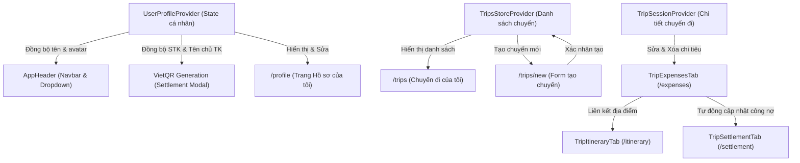

# KẾ HOẠCH TRIỂN KHAI PHASE 2G — HỒ SƠ CÁ NHÂN & HOÀN THIỆN UI/UX RELEASE 1

**Ngày lập:** 19/10/2026  
**Trạng thái:** Chờ phê duyệt (Pending Approval)  
**Tài liệu liên quan:** `PROJECT_CONTEXT.md`, `docs/ENGINEERING_STANDARDS.md`, `docs/DEFINITION_OF_DONE.md`, `sodothietke/release1-erd.dbml`, `sodothietke/release1-usecase.drawio`  
**Màn hình Stitch tham chiếu:**  
- `6955882969a64c97a080b470be654877` — **Hồ sơ của tôi** (`h_s_c_a_t_i`)  
- `a6c9807bc90e4e5ea5e177fbea41692b` — **Tạo chuyến đi** (`t_o_chuy_n_i`)  
- `91c26aca60d84e45a62be0ca3d8036a0` — **Thêm/sửa khoản chi** (`th_m_kho_n_chi_l_t_3n2`)  
- `e30ef5e11827405f88dd12f5cd83f873` — **Chuyến đi của tôi** (`chuy_n_i_c_a_t_i`)  

---

## 1. PHẠM VI VÀ MỤC TIÊU

### 1.1. Mục tiêu cốt lõi
Phase 2G là bước hoàn thiện cuối cùng của giao diện người dùng (UI/UX) cho **Release 1**, giải quyết triệt để 4 khoảng trống chức năng còn lại được chỉ ra trong báo cáo kiểm thử UI/UX:
1. **Hồ sơ cá nhân và tài khoản nhận tiền VietQR (UC02)**: Xây dựng trang Hồ sơ của tôi theo đúng thiết kế Stitch, cho phép cập nhật thông tin cá nhân và thông tin ngân hàng phục vụ thanh toán quyết toán.
2. **Sửa và xóa khoản chi tiêu (UC13)**: Hoàn thiện tính năng chỉnh sửa và xóa khoản chi trong tab Chi tiêu, bảo toàn các ràng buộc chia tiền và tính toàn vẹn liên kết với địa điểm lịch trình.
3. **Đồng bộ luồng tạo chuyến đi (UC03)**: Kết nối biểu mẫu tạo chuyến đi `/trips/new` với danh sách chuyến đi `/trips`, đảm bảo chuyến đi mới tạo xuất hiện nhất quán trong phiên làm việc demo.
4. **Rà soát và kích hoạt các tương tác còn thiếu**: Kích hoạt menu tài khoản, chuông thông báo demo, chỉnh sửa thông tin chuyến đi (UC23), lưu trữ chuyến đi (UC24) và hoàn thiện các trạng thái xác nhận nguy hiểm.

### 1.2. Giới hạn kỹ thuật và phạm vi loại trừ
- **Chỉ triển khai Frontend React Session State**: Toàn bộ dữ liệu hồ sơ cá nhân, ngân hàng, chuyến đi và chi tiêu được lưu trữ trong React Context/Session Store của Release 1.
- **Không tích hợp backend**: Không tích hợp PostgreSQL, Prisma ORM, Auth.js / NextAuth production, hay các API ngân hàng/Napas thật.
- **Không khẳng định xác thực thật**: Ghi chú rõ ràng đây là dữ liệu minh họa, không xác thực quyền sở hữu tài khoản ngân hàng thực tế.
- **Bảo toàn các phase đã nghiệm thu**: Không làm hỏng hoặc thay đổi bất kỳ logic tính toán tài chính nào của Phase 2C, 2D, 2E và 2F.

---

## 2. DANH SÁCH ROUTE, COMPONENT VÀ FILE DỰ KIẾN TẠO / SỬA

### 2.1. Routes & Pages (`src/app/`)
| File | Loại thay đổi | Trách nhiệm |
|---|:---:|---|
| `src/app/(app)/profile/page.tsx` | **Tạo mới** | Route Hồ sơ cá nhân (`/profile`), bọc Suspense, render bố cục 12 cột chuẩn Stitch |
| `src/app/(app)/trips/page.tsx` | Sửa | Kết nối với `TripsSessionProvider` để hiển thị chuyến đi mới tạo |
| `src/app/(app)/trips/new/page.tsx` | Giữ nguyên | Trang tạo chuyến đi hiện tại (đã chuẩn form) |

### 2.2. State & Data Layer (`src/lib/` & Context)
| File | Loại thay đổi | Trách nhiệm |
|---|:---:|---|
| `src/types/user.ts` | **Tạo mới** | Định nghĩa `UserProfile`, `UserBankInfo`, `UpdateProfileFormData`, `UpdateBankFormData`, `NotificationItem` |
| `src/lib/user/user-context.tsx` | **Tạo mới** | `UserProfileProvider` & hook `useUserProfile`: Quản lý state thông tin cá nhân và ngân hàng của người dùng hiện tại (Lan Nguyễn), đồng bộ với VietQR |
| `src/lib/user/validation.ts` | **Tạo mới** | Logic validation cho hồ sơ cá nhân và thông tin ngân hàng VietQR |
| `src/lib/user/validation.test.ts` | **Tạo mới** | Bộ unit test kiểm tra toàn diện validation hồ sơ và ngân hàng |
| `src/lib/mock/banks.ts` | **Tạo mới** | Danh sách 15 ngân hàng phổ biến nhất tại Việt Nam kèm mã BIN chuẩn Napas (VCB, TCB, MB, VPB, CTG, BIDV, ACB, TPB...) |
| `src/lib/trips/trips-store-context.tsx` | **Tạo mới** | `TripsStoreProvider` & hook `useTripsStore`: Quản lý danh sách chuyến đi trong session, hỗ trợ thêm chuyến đi mới, chỉnh sửa thông tin chuyến (UC23), lưu trữ chuyến (UC24) |
| `src/components/trips/detail/trip-session-context.tsx` | Sửa | Bổ sung handlers: `handleUpdateExpense`, `handleDeleteExpense`, `handleUpdateTripInfo`, `handleArchiveTrip` |

### 2.3. Components Hồ sơ cá nhân (`src/components/profile/`)
| File | Loại thay đổi | Trách nhiệm |
|---|:---:|---|
| `src/components/profile/profile-view.tsx` | **Tạo mới** | Bố cục tổng thể 12 cột (3 cột sidebar trái, 9 cột nội dung phải) |
| `src/components/profile/profile-sidebar.tsx` | **Tạo mới** | Mini profile tóm tắt, menu chuyển tab anchor, thông số tin cậy bậc 3, nút Đăng xuất |
| `src/components/profile/profile-personal-section.tsx` | **Tạo mới** | Section 1: Form sửa Họ tên, Tên hiển thị, Email (khóa), Số điện thoại, avatar picker |
| `src/components/profile/profile-bank-section.tsx` | **Tạo mới** | Section 2: Form cấu hình ngân hàng thụ hưởng, số tài khoản (kèm nút sao chép), tên chủ tài khoản viết hoa không dấu, chi nhánh |
| `src/components/profile/profile-vietqr-card.tsx` | **Tạo mới** | Thẻ xem trước VietQR Napas 247 thực tế với SVG QR code render theo thông tin tài khoản |
| `src/components/profile/profile-qr-zoom-modal.tsx` | **Tạo mới** | Modal phóng to mã VietQR để quét trực tiếp |

### 2.4. Components Chi tiêu & Lịch trình (`src/components/trips/`)
| File | Loại thay đổi | Trách nhiệm |
|---|:---:|---|
| `src/components/trips/expenses/trip-expense-form-modal.tsx` | Sửa | Nâng cấp hỗ trợ cả 2 chế độ: Thêm mới & Chỉnh sửa (`initialExpense`), nạp sẵn dữ liệu cũ, nút Xóa |
| `src/components/trips/expenses/trip-expense-row.tsx` | Sửa | Bổ sung nút thao tác (Chỉnh sửa / Xóa) cho người có thẩm quyền |
| `src/components/trips/expenses/trip-expenses-tab.tsx` | Sửa | Nối state và handlers chỉnh sửa/xóa khoản chi, tích hợp với Session Context |
| `src/components/trips/expenses/trip-expense-delete-modal.tsx` | **Tạo mới** | Modal xác nhận xóa khoản chi (cảnh báo tác động đến phần chia tiền) |
| `src/components/trips/create-trip-preview-modal.tsx` | Sửa | Đổi nút xác nhận thành "Tạo chuyến đi & Bắt đầu", gọi `addTrip` và chuyển trang |
| `src/components/trips/detail/trip-edit-info-modal.tsx` | **Tạo mới** | Modal chỉnh sửa thông tin chuyến đi (Tên, Điểm đến, Thời gian, Ngân sách) cho Trưởng nhóm |
| `src/components/trips/detail/trip-detail-header.tsx` | Sửa | Thêm nút "Chỉnh sửa chuyến đi" cho Trưởng nhóm khi trạng thái `ACTIVE` |

### 2.5. Layout & Navigation (`src/components/layout/`)
| File | Loại thay đổi | Trách nhiệm |
|---|:---:|---|
| `src/components/layout/app-header.tsx` | Sửa | Thêm link "Hồ sơ của tôi" trên thanh điều hướng, kích hoạt menu Hồ sơ cá nhân trong dropdown, kết nối chuông thông báo |
| `src/components/layout/notification-popover.tsx` | **Tạo mới** | Popover danh sách thông báo mẫu Release 1 kèm nút đánh dấu đã đọc |

---

## 3. QUY TẮC NGHIỆP VỤ VÀ MA TRẬN QUYỀN

### 3.1. Ma trận quyền thao tác (Permission Matrix)

| Hành động | Trưởng nhóm (HOST) | Người trả tiền (PAYER) | Thành viên khác (MEMBER) | Ghi chú & Ràng buộc |
|---|:---:|:---:|:---:|---|
| **Xem hồ sơ & cập nhật STK cá nhân** | Toàn quyền | Toàn quyền | Toàn quyền | Mỗi người chỉ quản lý hồ sơ của chính mình |
| **Thêm khoản chi mới** | Cho phép | Cho phép | Cho phép | Ghi cho bản thân hoặc Trưởng nhóm ghi hộ (R18) |
| **Chỉnh sửa khoản chi** | Cho phép | Cho phép | Không | Chỉ khi chuyến đi ở trạng thái `ACTIVE` |
| **Xóa khoản chi** | Cho phép | Cho phép | Không | Chỉ khi chuyến đi ở trạng thái `ACTIVE` |
| **Chỉnh sửa thông tin chuyến đi** | Cho phép | Không | Không | UC23: Tên, điểm đến, ngày, ngân sách |
| **Lưu trữ / Hủy chuyến đi** | Cho phép | Không | Không | UC24, Rule R15 |
| **Tạo chuyến đi mới** | Cho phép | Cho phép | Cho phép | Ai cũng có thể tạo chuyến mới và trở thành Host |

### 3.2. Ma trận theo trạng thái chuyến đi

| Trạng thái chuyến đi | Sửa/Xóa chi tiêu | Sửa thông tin chuyến | Lưu trữ chuyến | Xem hồ sơ & STK |
|---|:---:|:---:|:---:|:---:|
| **Đang lên kế hoạch (`ACTIVE`)** | **Cho phép** | **Cho phép** | **Cho phép** | Cho phép |
| **Đang thanh toán (`SETTLING`)** | **Bị khóa** | **Bị khóa** | **Bị khóa** | Cho phép |
| **Đã hoàn tất (`COMPLETED`)** | **Bị khóa** | **Bị khóa** | **Cho phép (Lưu trữ)** | Cho phép |
| **Đã lưu trữ (`ARCHIVED`)** | **Bị khóa** | **Bị khóa** | Đã lưu trữ | Cho phép |

### 3.3. Các bất biến tài chính và dữ liệu liên kết
1. **Bất biến bảo toàn chi tiêu**: Khi sửa một khoản chi, $\sum \text{shares} = \text{amount}$ bắt buộc phải được bảo toàn theo thuật toán chia đã chọn (EQUAL hoặc ITEMIZED).
2. **Deterministic Remainder**: Khi sửa khoản chi chia đều, các đồng lẻ dư ra được phân bổ tuần tự cho các thành viên có `join_order` nhỏ nhất.
3. **Tính toàn vẹn liên kết Lịch trình**: Khi một khoản chi bị xóa, nếu có địa điểm lịch trình nào đang tham chiếu tới khoản chi đó (`itineraryItem.expenseId === deletedId`), hệ thống tự động đặt `expenseId = null`. Không xóa địa điểm lịch trình.
4. **Chuẩn hóa tên chủ tài khoản (Rule R9)**: Tên chủ tài khoản tự động được viết HOA không dấu (ví dụ: `NGUYEN PHUONG LAN`), loại bỏ ký tự đặc biệt.
5. **Ràng buộc ngày tháng chuyến đi**: `endDate >= startDate`.

---

## 4. PHƯƠNG ÁN TÍCH HỢP STATE

### 4.1. Hồ sơ người dùng và Ngân hàng (`UserProfileProvider`)
- Cung cấp state toàn cục cho toàn bộ ứng dụng phía client:
  ```typescript
  export interface UserProfile {
    id: string;
    fullName: string;
    displayName: string;
    email: string;
    phoneNumber?: string;
    avatarUrl?: string | null;
    bankInfo?: {
      bankBin: string;
      bankName: string;
      accountNumber: string;
      accountHolder: string;
      branch?: string;
    } | null;
  }
  ```
- Đồng bộ dữ liệu 2 chiều:
  - Khi người dùng cập nhật tên hiển thị hoặc ngân hàng ở trang `/profile`:
    1. Cập nhật `userProfile` trong context.
    2. Header tự động hiển thị tên và avatar mới.
    3. Tab Công nợ (`/trips/[id]/settlement`) tự động sử dụng `bankInfo` mới này để sinh mã VietQR khi người khác thanh toán cho Lan Nguyễn (`m1`).
  - Nếu chưa thiết lập STK: Thẻ VietQR hiển thị trạng thái hướng dẫn thiết lập; trong bảng công nợ hiển thị tùy chọn thanh toán tiền mặt (Rule R17).

### 4.2. Khoản chi tiêu trong `TripSessionProvider`
- Bổ sung 2 hàm xử lý:
  - `handleUpdateExpense(id: string, formData: CreateExpenseFormData)`:
    - Tính toán lại toàn bộ `shares` (chia đều hoặc chia theo món) dựa trên danh sách `sessionMembers` hiện tại.
    - Cập nhật dòng chi tiêu trong `sessionExpenses`.
    - Tự động kích hoạt tính toán lại `sessionTotalSpent`, `sessionTrip`, `calculateMemberBalances`, và `previewTransfers`.
    - Hiển thị toast: "Đã cập nhật khoản chi thành công (dữ liệu demo)."
  - `handleDeleteExpense(id: string)`:
    - Lọc bỏ khoản chi khỏi `sessionExpenses`.
    - Duyệt `sessionItinerary`: nếu có địa điểm nào có `expenseId === id`, cập nhật `expenseId = null`.
    - Tự động kích hoạt tính toán lại toàn bộ số dư và bảng quyết toán.
    - Hiển thị toast: "Đã xóa khoản chi."

### 4.3. Quản lý danh sách chuyến đi (`TripsStoreProvider`)
- Lưu trữ danh sách chuyến đi trong session (`sessionTrips: Trip[]`), khởi tạo từ `MOCK_TRIPS`.
- `handleAddTrip(formData: CreateTripFormData)`:
  - Sinh mã mời mới hợp lệ (10-12 ký tự chữ/số kèm 1 dấu gạch nối).
  - Khởi tạo chuyến đi mới với `status: 'ACTIVE'`, `members: [currentUserAsHost]`, `budgetAmount: formData.budgetAmount`.
  - Thêm vào đầu danh sách `sessionTrips`.
  - Điều hướng người dùng thẳng vào `/trips/[newTripId]` để người dùng trải nghiệm ngay việc thêm địa điểm lịch trình và mời bạn bè.
- `handleUpdateTripInfo(tripId: string, data: Partial<Trip>)`: Cập nhật tên, điểm đến, ngày đi - về hoặc ngân sách dự kiến của chuyến đi.
- `handleArchiveTrip(tripId: string)`: Chuyển trạng thái sang `ARCHIVED` (Rule R15).

---

## 5. CÁC PHỤ THUỘC GIỮA CHỨC NĂNG



---

## 6. DANH SÁCH KIỂM THỬ (TEST PLAN)

### 6.1. Logic & Validation Tests (`vitest`)
1. **Kiểm tra Validation Hồ sơ cá nhân (`src/lib/user/validation.test.ts`)**:
   - Họ tên rỗng, quá ngắn (<2 ký tự) hoặc quá dài (>100 ký tự).
   - Tên hiển thị rỗng hoặc không hợp lệ.
   - Số điện thoại sai định dạng (không phải đầu số di động VN hoặc sai độ dài).
   - Hợp lệ khi nhập đầy đủ thông tin chuẩn.
2. **Kiểm tra Validation Thông tin Ngân hàng VietQR**:
   - Chọn ngân hàng không có trong danh mục Napas.
   - Số tài khoản chứa ký tự đặc biệt hoặc quá ngắn (<6 ký tự).
   - Tên chủ tài khoản tự động được chuyển thành chữ HOA không dấu.
   - Trường hợp không nhập ngân hàng: Hợp lệ nếu người dùng chọn để trống (chưa cấu hình).
3. **Kiểm tra Logic Sửa/Xóa khoản chi**:
   - Sửa khoản chi chia đều: Tổng shares mới bằng đúng số tiền mới; bảo toàn `join_order` determinism.
   - Sửa khoản chi theo món: Tổng món + phụ phí khớp đúng số tiền mới.
   - Xóa khoản chi: Khoản chi biến mất khỏi mảng; các địa điểm lịch trình có `expenseId` tương ứng được đặt lại thành `null`.
   - Chặn sửa/xóa khi chuyến đi ở trạng thái `SETTLING` hoặc `COMPLETED`.

### 6.2. Browser & Visual QA
1. **Trang Hồ sơ cá nhân (`/profile`)**:
   - Desktop (1280px), Tablet (768px), Mobile (375px).
   - Kiểm tra bố cục 12 cột, sidebar trái dính (sticky), thẻ VietQR render sắc nét.
   - Thử sửa Tên hiển thị thành "Lan Hương", bấm "Lưu thay đổi", kiểm tra avatar và tên trên Header cập nhật tức thì.
   - Thử sửa STK ngân hàng thành "0071001234567" (Vietcombank), kiểm tra mã VietQR cập nhật thời gian thực.
   - Bấm nút "Phóng to QR", kiểm tra modal hiển thị mã QR lớn phục vụ quét trực tiếp.
2. **Sửa và Xóa khoản chi (`/trips/trip-dalat-3n2d/expenses`)**:
   - Mở tab Chi tiêu, bấm nút Chỉnh sửa trên dòng "Bánh ướt lòng gà Long".
   - Thay đổi số tiền từ 1.060.000 ₫ thành 1.200.000 ₫, bấm "Lưu thay đổi".
   - Kiểm tra số tiền cập nhật, tổng chi tiêu tăng lên tương ứng và số dư công nợ thay đổi chính xác.
   - Bấm nút Xóa trên một khoản chi, kiểm tra modal xác nhận nguy hiểm xuất hiện. Bấm xác nhận, khoản chi biến mất và tổng chi tiêu giảm đúng giá trị.
3. **Luồng Tạo chuyến đi (`/trips/new`)**:
   - Nhập thông tin chuyến đi mới "Hà Giang 4N3Đ", ngân sách 15.000.000 ₫.
   - Bấm "Xem trước", modal preview mở ra với toàn bộ thông tin đã nhập.
   - Bấm "Tạo chuyến đi & Bắt đầu", hệ thống điều hướng vào `/trips/[newId]` và hiển thị chuyến đi mới trong danh sách `/trips`.
   - Thử bấm "Hủy bỏ" trong form, modal xác nhận hủy xuất hiện; chọn đồng ý hủy, quay về `/trips` và không có chuyến đi rác nào được tạo.
4. **Tương tác Header & Chuông thông báo**:
   - Bấm chuông thông báo: Popover hiển thị các thông báo mẫu của Release 1.
   - Bấm "Đánh dấu đã đọc tất cả": Chấm đỏ biến mất.
   - Mở dropdown tài khoản: Bấm "Hồ sơ cá nhân" điều hướng mượt mà sang `/profile`.

---

## 7. TIÊU CHÍ NGHIỆM THU CÓ THỂ KIỂM CHỨNG (ACCEPTANCE CRITERIA)

- [ ] **AC-1**: Truy cập được route `/profile` với giao diện chuẩn Stitch `h_s_c_a_t_i`.
- [ ] **AC-2**: Cập nhật được thông tin cá nhân (Họ tên, Tên hiển thị, SĐT) có validation và hiển thị toast thành công.
- [ ] **AC-3**: Cập nhật được thông tin ngân hàng (Ngân hàng, STK, Tên chủ TK hoa không dấu) và mã VietQR SVG preview hiển thị tương ứng.
- [ ] **AC-4**: Thay đổi thông tin cá nhân/ngân hàng được đồng bộ sang Header và modal quyết toán trong chuyến đi.
- [ ] **AC-5**: Có thể chỉnh sửa khoản chi tiêu khi chuyến đi `ACTIVE`; bảo toàn tính chia đều hoặc chia theo món và bất biến $\sum \text{shares} = \text{amount}$.
- [ ] **AC-6**: Có thể xóa khoản chi tiêu khi chuyến đi `ACTIVE`; có modal xác nhận nguy hiểm; tự động gỡ liên kết `expenseId` ở địa điểm lịch trình liên quan.
- [ ] **AC-7**: Nút sửa/xóa khoản chi bị vô hiệu hóa hoặc ẩn khi chuyến đi ở trạng thái `SETTLING` hoặc `COMPLETED`.
- [ ] **AC-8**: Chuyến đi tạo mới tại `/trips/new` xuất hiện ngay lập tức trong danh sách phiên làm việc tại `/trips`.
- [ ] **AC-9**: Hủy form tạo chuyến đi không tạo dữ liệu mới vào hệ thống.
- [ ] **AC-10**: Nút chuông thông báo mở popover thông báo mẫu có chức năng đánh dấu đã đọc.
- [ ] **AC-11**: Menu tài khoản trong Header dẫn đến đúng trang `/profile`.
- [ ] **AC-12**: Trưởng nhóm có thể chỉnh sửa thông tin chuyến đi (Tên, ngày, ngân sách) qua modal khi chuyến `ACTIVE`.
- [ ] **AC-13**: Toàn bộ unit tests (249 tests cũ + các tests mới của Phase 2G) đều PASS.
- [ ] **AC-14**: `npm run lint` đạt 0 lỗi, 0 cảnh báo.
- [ ] **AC-15**: `npm run build` thành công không có lỗi TypeScript hay Next.js Turbopack.
- [ ] **AC-16**: Browser QA đạt yêu cầu trên cả 3 kích thước: Desktop 1280px, Tablet 768px, Mobile 375px.

---

## 8. CÁC RỦI RO, GIỚI HẠN VÀ CÂU HỎI CẦN PHÊ DUYỆT

### 8.1. Rủi ro và giải pháp
1. **Rủi ro mất dữ liệu khi F5 (Session-only State)**:
   - *Phân tích*: Không có database PostgreSQL thật, việc tải lại trang cứng (hard refresh) sẽ đưa state về dữ liệu mock ban đầu.
   - *Giải pháp*: Hiển thị thông báo hoặc tooltip giải thích minh bạch trong chế độ thử nghiệm của Release 1.
2. **Rủi ro xung đột số dư khi sửa/xóa khoản chi**:
   - *Phân tích*: Khi sửa số tiền của khoản chi, nếu không đồng bộ lại `calculateMemberBalances`, số dư cá nhân và các giao dịch đề xuất thanh toán có thể bị sai.
   - *Giải pháp*: Mọi thao tác sửa/xóa chi tiêu đều kích hoạt hàm tính toán số dư cốt lõi `calculateMemberBalances` trong `TripSessionProvider`.

### 8.2. Bốn câu hỏi nghiệp vụ cần người dùng duyệt trước khi triển khai

#### Q1 — Định dạng đường dẫn cho trang Hồ sơ của tôi
- **Phương án 1 (Khuyến nghị)**: Sử dụng route `/profile` (chuẩn quốc tế, ngắn gọn, thân thiện, nằm trong route group `(app)`).
- **Phương án 2**: Sử dụng route `/account` hoặc `/user/profile`.
- *Đề xuất*: Chọn **Phương án 1**.

#### Q2 — Quyền chỉnh sửa và xóa khoản chi tiêu
- **Phương án 1 (Khuyến nghị)**: Cả **Người đã trả tiền** (`paidByMemberId === currentUserId`) VÀ **Trưởng nhóm** (`isHost === true`) đều có quyền sửa hoặc xóa khoản chi (phù hợp với vai trò điều phối của Host). Các thành viên khác chỉ được xem.
- **Phương án 2**: Chỉ duy nhất Người đã trả tiền mới có quyền sửa/xóa; Trưởng nhóm chỉ được quyền xem.
- *Đề xuất*: Chọn **Phương án 1**.

#### Q3 — Hướng điều hướng sau khi tạo chuyến đi thành công
- **Phương án 1 (Khuyến nghị)**: Điều hướng thẳng người dùng vào trang Tổng quan của chuyến đi mới tạo `/trips/[newId]` để họ có thể bắt đầu thêm lịch trình và mời bạn bè ngay.
- **Phương án 2**: Điều hướng về danh sách chuyến đi `/trips` kèm toast thông báo thành công.
- *Đề xuất*: Chọn **Phương án 1**.

#### Q4 — Xử lý tương tác Chuông thông báo trong Release 1
- **Phương án 1 (Khuyến nghị)**: Triển khai `NotificationPopover` chứa 3 thông báo mẫu tương ứng với các sự kiện trong phiên demo (yêu cầu nhận diện danh tính, nhắc nợ, thanh toán hoàn tất) kèm nút "Đánh dấu đã đọc" để hoàn thiện 100% UI.
- **Phương án 2**: Giữ nguyên nút chuông và khi bấm chỉ hiển thị thông báo toast: "Chức năng thông báo thời gian thực thuộc Release sau."
- *Đề xuất*: Chọn **Phương án 1**.

---

## 9. CHECKLIST TỔNG THỂ ĐỂ NGHIỆM THU UI/UX RELEASE 1

Checklist này là tiêu chuẩn đánh giá cuối cùng để khẳng định giao diện và trải nghiệm người dùng của Release 1 đã hoàn thiện 100% trước khi bước sang tích hợp cơ sở dữ liệu và backend:

- [ ] **1. Xác thực & Khách ghé thăm**:
  - Landing page `/` hiển thị đẹp mắt, nút CTA hoạt động.
  - Trang đăng nhập `/login` mô phỏng đăng nhập Google một chạm.
  - Route xem trước lời mời `/join/[code]` chuẩn Rule R19 (không lộ tài chính, có modal nhận diện danh tính & waiting state).
- [ ] **2. Quản trị Chuyến đi**:
  - Trang danh sách `/trips` có đầy đủ 3 trạng thái bộ lọc (Tất cả, Đang hoạt động, Đã hoàn tất), bộ sắp xếp, thanh tổng hợp số dư.
  - Form tạo chuyến đi `/trips/new` có validation, quick pills điểm đến, preset ngân sách, preview modal và tạo chuyến thành công vào danh sách.
  - Trang tổng quan `/trips/[id]` có thanh ngân sách tiến độ, 3 chỉ số tài chính, danh sách gần đây, danh sách thành viên và mã mời 1-click copy.
- [ ] **3. Quản lý Lịch trình (`/trips/[id]/itinerary`)**:
  - Dòng thời gian lịch trình 8-4 hiển thị theo ngày.
  - Thêm, sửa, xóa địa điểm lịch trình.
  - Cảnh báo thời gian chồng lấn màu cam, không chặn lưu.
  - Phân quyền Trưởng nhóm & người tạo địa điểm.
- [ ] **4. Quản lý Chi tiêu (`/trips/[id]/expenses`)**:
  - Bộ lọc danh mục, thành viên và tìm kiếm văn bản.
  - Thêm khoản chi chia đều (bảo toàn đồng lẻ `join_order`).
  - Thêm khoản chi theo món (Itemized Split) kèm phụ phí.
  - Sửa và xóa khoản chi tiêu (bảo toàn ràng buộc tài chính và liên kết lịch trình).
  - Xem ảnh chứng từ/hóa đơn bằng Lightbox modal.
- [ ] **5. Quyết toán & Công nợ (`/trips/[id]/settlement`)**:
  - Bảng tổng hợp công nợ đa phương với quy tắc Zero-Sum.
  - Đề xuất thanh toán tối ưu hóa (Simplify Debts) số lượng giao dịch tối thiểu.
  - Modal thanh toán chuyển khoản hiển thị mã VietQR SVG sắc nét kèm cú pháp chuyển khoản chuẩn.
  - Đánh dấu đã thanh toán, xác nhận đã nhận tiền và mở lại sổ công nợ.
- [ ] **6. Quản lý Thành viên (`/trips/[id]/members`)**:
  - Bảng thành viên kèm thống kê chi tiêu và số dư ròng.
  - Thêm thành viên chưa có tài khoản, chỉnh sửa tên hiển thị.
  - Xóa thành viên / rời nhóm có kiểm tra số dư công nợ (Rule R6: Soft-delete sang `LEFT`).
  - Trưởng nhóm duyệt hoặc từ chối yêu cầu nhận diện danh tính.
- [ ] **7. Hồ sơ cá nhân (`/profile`)**:
  - Cập nhật Họ tên, Tên hiển thị, Số điện thoại.
  - Cấu hình thông tin ngân hàng thụ hưởng và thẻ VietQR demo xem trước.
  - Đồng bộ thông tin ngân hàng với hệ thống quyết toán.
- [ ] **8. Độ hoàn thiện tương tác & Thiết kế (Polish & Aesthetics)**:
  - Hệ thống Design Tokens Coastal Palette (Lime Wash, Cerulean, Yale Blue) nhất quán 100%.
  - Kiểu chữ Be Vietnam Pro hỗ trợ dấu tiếng Việt hoàn hảo, số tiền dùng `tabular-nums`.
  - Đáp ứng trọn vẹn Responsive trên 3 kích thước: Desktop (1280px), Tablet (768px), Mobile (375px).
  - Không còn bất kỳ nút hay liên kết "chết" nào trên giao diện chính thức.
