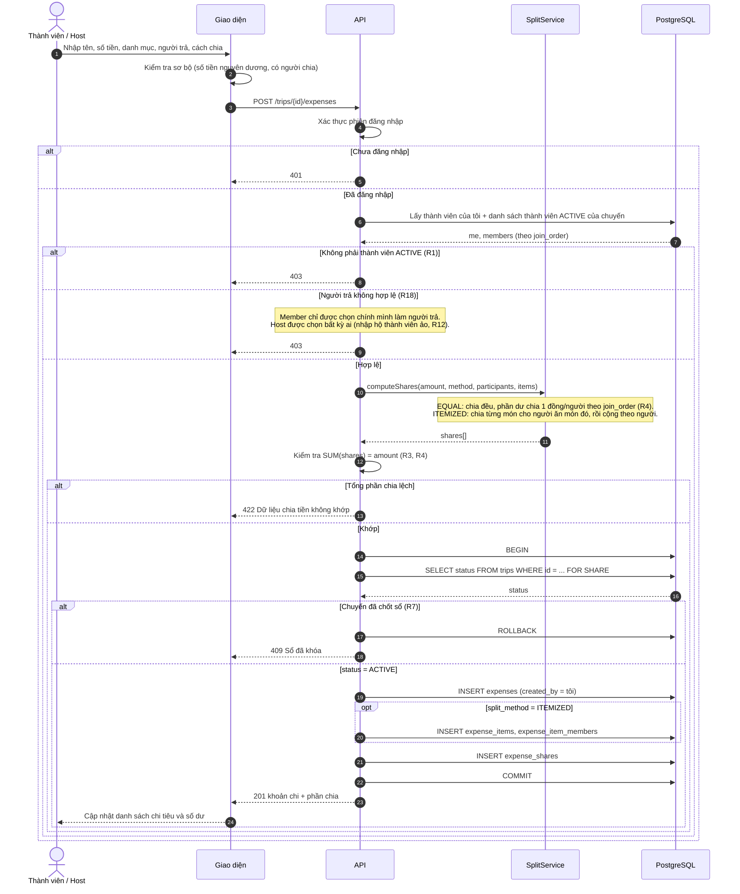
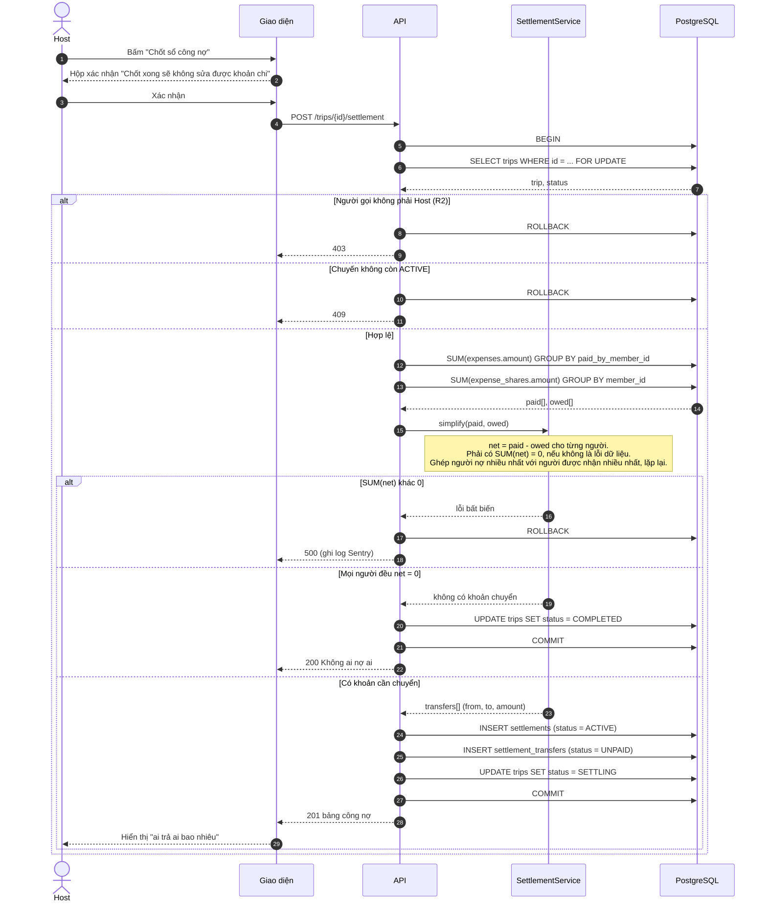
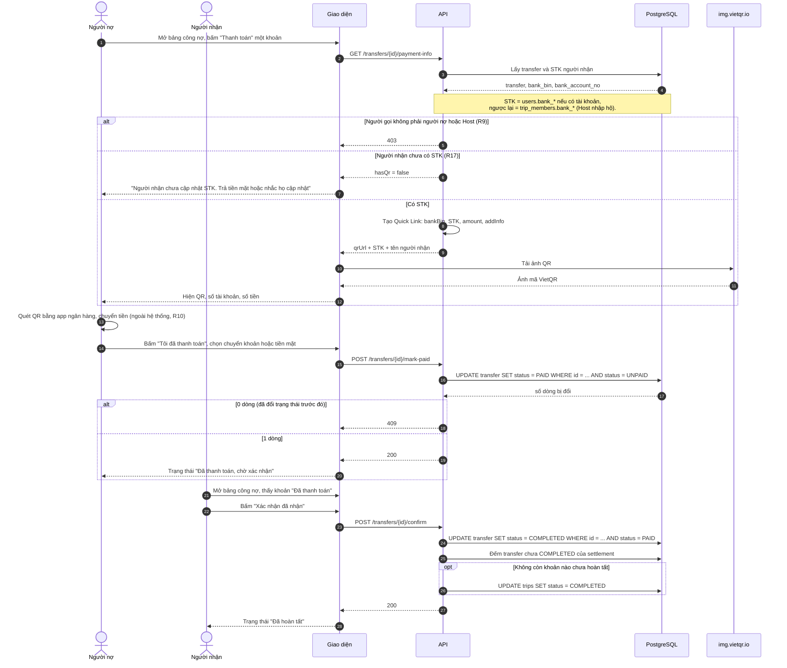
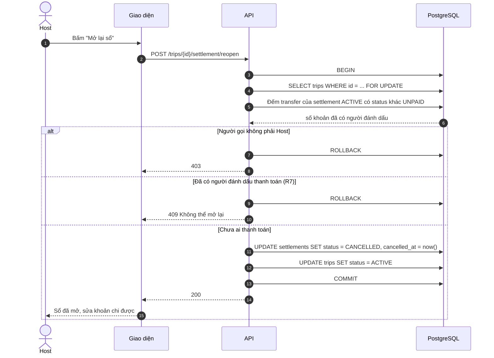
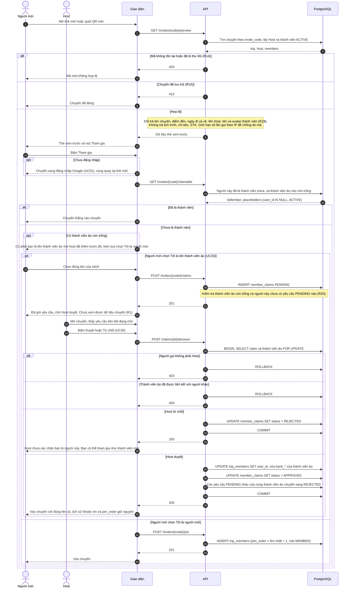

# Release 1 - Sơ đồ tuần tự (Sequence Diagram)

Cách xem: dán từng khối `mermaid` vào https://mermaid.live (xem, sửa, xuất PNG/SVG). GitHub cũng tự vẽ các khối này khi bạn mở file `.md` trong repo.

Quy ước tên: **UI** = giao diện Next.js trên trình duyệt, **API** = Route Handler phía server, **DB** = PostgreSQL. Mã R1-R18 là quy tắc nghiệp vụ, UC là use case.

---

## SD1. Thêm khoản chi và chia tiền (UC11, UC12, UC31)



Điểm cần nhớ: việc kiểm tra "chuyến đã chốt sổ chưa" nằm **trong transaction** với `FOR SHARE`. Nếu Host đang chốt sổ cùng lúc (SD2 dùng `FOR UPDATE` trên cùng dòng), một trong hai sẽ phải chờ, nên không thể có khoản chi lọt vào sau khi sổ đã tính xong.

---

## SD2. Chốt sổ và rút gọn nợ (UC15, UC16)



---

## SD3. Thanh toán, tạo QR và xác nhận (UC19, UC18, UC20)



Ghi chú: người nhận là thành viên không tài khoản thì Host bấm xác nhận thay (R12). Người nợ là thành viên không tài khoản thì Host bấm "Tôi đã thanh toán" thay.

---

## SD4. Mở lại sổ công nợ (UC22)



---

## SD5. Tham gia chuyến qua link/QR và nhận diện thành viên ảo (UC05, UC33, UC30, UC34)



**Vì sao bắt buộc Host duyệt, không cho tự động liên kết:** thành viên ảo có thể đang được nợ tiền hoặc đang đứng tên người nhận. Nếu ai có link cũng tự nhận được "Nam" thì họ nhận luôn khoản tiền của Nam. Bước duyệt chặn việc đó.

**Các quy tắc đi kèm SD5**

| # | Quy tắc | |
|---|---|---|
| R13 | Người mới có thể yêu cầu liên kết với một thành viên ảo (UC33). Chỉ khi Host duyệt (UC30) mới gán `user_id`; lịch sử, `join_order` giữ nguyên. Chưa duyệt thì người đó chưa xem được dữ liệu chuyến. Bị từ chối thì tham gia như thành viên mới | Sửa |
| R19 | Người có mã mời hợp lệ chỉ xem được thẻ xem trước (tên chuyến, điểm đến, ngày, tên Host, tên và avatar thành viên). Không thấy lịch trình, chi tiêu, STK. Mã mời đủ dài và ngẫu nhiên, giới hạn số lần thử theo IP | Mới |
| R20 | Mỗi tài khoản tối đa 1 yêu cầu PENDING mỗi chuyến. Một thành viên ảo chỉ liên kết được với 1 tài khoản; khi một yêu cầu được duyệt, các yêu cầu PENDING khác của cùng thành viên ảo tự bị từ chối | Mới |

**QR mời (UC34):** sinh ngay trên trình duyệt từ link mời bằng thư viện QR (ví dụ `qrcode`), không gọi dịch vụ ngoài và không cần API riêng, nên không có sơ đồ tuần tự.

---

## Thuật toán và test cần viết (phần tiền, sai một đồng cũng là lỗi)

**Chia đều có phần dư (R4)**

```ts
// Trả về phần của từng người, theo đúng thứ tự join_order truyền vào
function splitEqual(amount: number, memberIds: string[]): Map<string, number> {
  const n = memberIds.length;
  const base = Math.floor(amount / n);
  const remainder = amount - base * n;           // 0 <= remainder < n
  const result = new Map<string, number>();
  memberIds.forEach((id, i) => result.set(id, base + (i < remainder ? 1 : 0)));
  return result;                                  // tổng luôn bằng amount
}
```

**Rút gọn nợ (greedy, gần tối ưu)**

```ts
function simplify(net: Map<string, number>) {     // net = đã trả - phải chịu
  const creditors = [...net].filter(([, v]) => v > 0).sort((a, b) => b[1] - a[1] || a[0].localeCompare(b[0]));
  const debtors   = [...net].filter(([, v]) => v < 0).map(([id, v]) => [id, -v] as [string, number])
                            .sort((a, b) => b[1] - a[1] || a[0].localeCompare(b[0]));
  const transfers: { from: string; to: string; amount: number }[] = [];
  let i = 0, j = 0;
  while (i < debtors.length && j < creditors.length) {
    const pay = Math.min(debtors[i][1], creditors[j][1]);
    transfers.push({ from: debtors[i][0], to: creditors[j][0], amount: pay });
    debtors[i][1] -= pay; creditors[j][1] -= pay;
    if (debtors[i][1] === 0) i++;
    if (creditors[j][1] === 0) j++;
  }
  return transfers;
}
```

Cách này có tối đa (số người có số dư khác 0) - 1 giao dịch. Tìm số giao dịch nhỏ nhất tuyệt đối là bài toán NP-khó, nên khi bảo vệ hãy nói rõ bạn dùng heuristic và lý do.

**Danh sách test tối thiểu (Vitest)**

| # | Test | Kỳ vọng |
|---|---|---|
| 1 | Chia 100.000 cho 3 người | 33.334 / 33.333 / 33.333, tổng 100.000 |
| 2 | Chia 1 đồng cho 3 người | 1 / 0 / 0 |
| 3 | Chia theo món: món X gán 2 người, món Y gán 1 người | Tổng phần chia = tổng hóa đơn |
| 4 | Ba người, mỗi người ứng một khoản khác nhau | SUM(net) = 0, số giao dịch tối đa 2 |
| 5 | Mọi người trả đúng phần của mình | Không có giao dịch nào |
| 6 | Chạy simplify 2 lần với cùng dữ liệu | Kết quả giống hệt (xác định) |

---

## Quyết định mới cần bạn xác nhận

| # | Nội dung |
|---|---|
| R18 (đề xuất) | Member chỉ được ghi khoản chi mà **chính mình** là người trả. Host được ghi hộ cho bất kỳ ai. Quy tắc này ngăn việc A nhập khoản chi giả "B đã trả" |
| VietQR | Quick Link dựng ảnh QR trên máy chủ của vietqr.io, nên **số tài khoản và số tiền được gửi sang bên thứ ba**. Với đồ án và beta kín thì chấp nhận được, nhưng cần ghi trong Chính sách bảo mật. Tài liệu VietQR cũng nói dự án chính thức cần tạo template riêng tại my.vietqr.io. Cách thay thế sau này: tự sinh QR trên server theo chuẩn VietQR/EMVCo bằng thư viện, không gửi dữ liệu ra ngoài |
